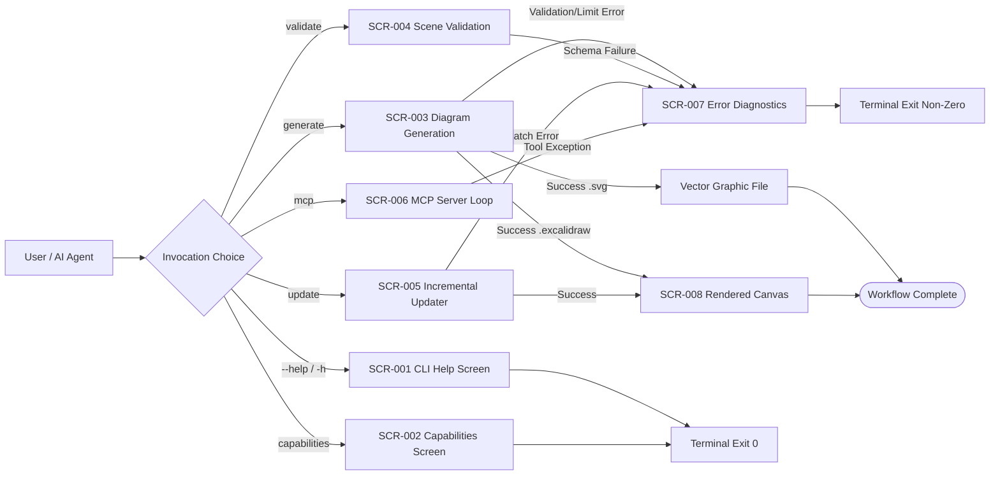
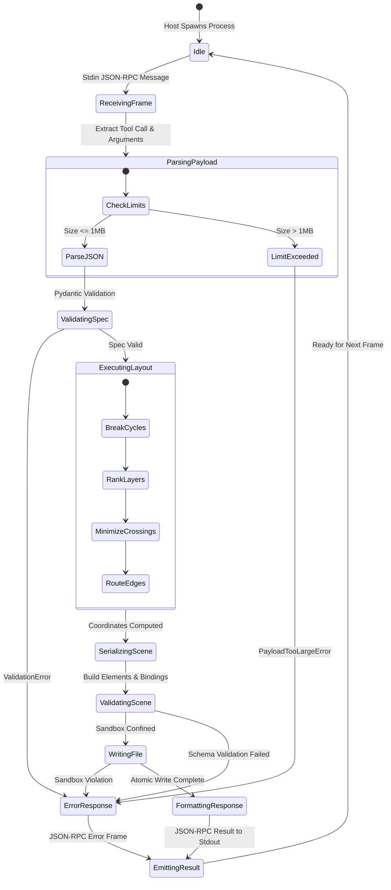
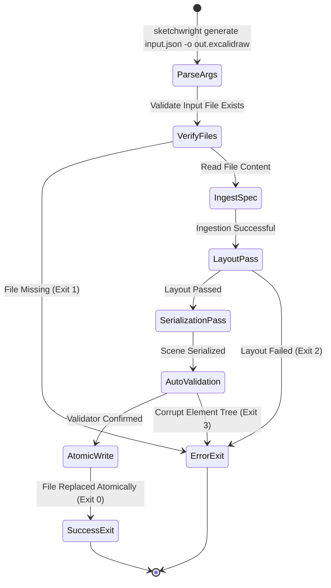

| Field | Value |
|---|---|
| Version | v1.0.0 |
| Last Updated | 2026-10-24 |
| Owner | Lead Systems Designer & QA Architect |
| Status | Approved |

# 📄 Application Flow & State Specification (AppFlow) — Sketchwright

## 1. State & Screen Inventory
Because Sketchwright operates as a headless CLI, library, and MCP stdio server, "screens" correspond to CLI terminal display states, MCP protocol interaction frames, and generated document visual presentations.

| ID | State / Screen Name | Purpose | Entry Points | Exit Points | Auth Required |
|---|---|---|---|---|:---:|
| `SCR-001` | **CLI Help & Usage Screen** | Displays command options, flags, and usage syntax | `sketchwright --help` | Terminal exit | N |
| `SCR-002` | **Capabilities Display Screen** | Outputs JSON capabilities, supported algorithms, and shapes | `sketchwright capabilities` | Terminal exit / stdout | N |
| `SCR-003` | **Diagram Generation Pipeline** | Ingests spec, runs layout, and emits `.excalidraw` or `.svg` | `sketchwright generate` / `sketchwright_generate` | Success exit / Error state | N |
| `SCR-004` | **Scene Validation Screen** | Validates scene schema, bindings, and geometry sanity | `sketchwright validate` / `sketchwright_validate` | Validated report / Error code | N |
| `SCR-005` | **Incremental Updater State** | Ingests patch, updates existing diagram, re-serializes | `sketchwright update` / `sketchwright_update` | Updated file / Error state | N |
| `SCR-006` | **MCP Stdio Server Loop** | Listens on stdin for JSON-RPC 2.0 frames, dispatches tools | `sketchwright mcp` | Process termination (SIGINT) | N |
| `SCR-007` | **Error & Diagnostics Terminal** | Formats and outputs structured errors to `stderr` | Any unhandled exception or validation failure | Non-zero exit code | N |
| `SCR-008` | **Rendered Excalidraw Canvas** | Final document opened in Excalidraw web app or desktop | Opening output file in Excalidraw | User canvas interaction | N |

## 2. Master Navigation & State Map

## 3. Detailed Journey State Diagrams

### 3.1 Journey 1: MCP Tool Invocation Lifecycle

### 3.2 Journey 2: CLI Generation & Validation Flow

## 4. Empty, Loading, and Error States Table
| State ID | Scenario / Condition | Visual / Stderr Presentation | Recovery Action |
|---|---|---|---|
| `ST-EMP-01` | Empty diagram spec (`{"nodes": [], "edges": []}`) | Generates an empty Excalidraw scene with zero elements | Valid; produces valid JSON canvas with metadata header. |
| `ST-EMP-02` | Node without label | Renders shape with default dimensions (120x60) without text child | Adds shape bounding box cleanly. |
| `ST-LOAD-01` | Large diagram layout in progress (> 300 nodes) | Diagnostic message emitted to `stderr`: `[INFO] Calculating Sugiyama ranking...` | Host awaits completion; no blocking logs sent to `stdout`. |
| `ST-ERR-01` | Malformed JSON syntax | Formatted error to `stderr`: `JSONDecodeError: Expecting ',' delimiter at line 14` | Host corrects JSON syntax and retries. |
| `ST-ERR-02` | Input exceeds 1 MB limit | `PayloadTooLargeError: Input payload 1,420,112 bytes exceeds limit of 1,048,576 bytes` | Split diagram or increase limits via `Settings`. |
| `ST-ERR-03` | Path traversal outside sandbox | `SandboxViolationError: Target path '/etc/passwd' escapes allowed directory 'F:/project'` | Specify path within allowed working directory. |
| `ST-ERR-04` | Collinear / dangling edge reference | `ValidationError: Edge 'e1' references undefined target node 'n99'` | Verify all edge `from_node` and `to_node` IDs exist. |

## 5. Edge Cases & Branching Logic
| Rule ID | IF Condition | THEN Route / Action |
|---|---|---|
| `BR-001` | Input contains cyclic dependencies (`A -> B -> C -> A`) | Route through DFS 3-color back-edge detection, temporarily reverse back-edges during ranking, restore original directions during serialization. |
| `BR-002` | Input graph contains multiple disconnected subgraphs | Partition into independent connected components, layout each individually, and pack components horizontally with `component_padding`. |
| `BR-003` | Node label length exceeds single-line threshold | Wrap text dynamically based on approximate character width, compute multiline text element, and expand container height. |
| `BR-004` | Node defines container `group` / frame | Group nodes into an Excalidraw `frame` element, compute frame bounding box enclosing all children with margin, and set `frameId` on children. |
| `BR-005` | Edge connects node to itself (`self-loop`) | Route as curved arc starting at top-center and terminating at right-center with 40px clearance. |
| `BR-006` | Output path extension is `.svg` | Bypass `.excalidraw` file writing and invoke the standalone vector SVG generator. |

## 6. Diagnostic Reporting & Output Channels
- **Standard Output (`stdout`)**:
  - Exclusively reserved for clean JSON-RPC 2.0 frames when running in MCP mode (`sketchwright mcp`).
  - Output of CLI command results (e.g. JSON strings for `capabilities`).
- **Standard Error (`stderr`)**:
  - All application logging, debugging traces, performance metrics, and human-readable error messages.
  - Guarantees zero stream contamination for AI hosts parsing `stdout`.

## 7. Cross-Platform Deltas
| Feature | Windows (Win32) | Linux / macOS (POSIX) | Handling Strategy |
|---|---|---|---|
| **Path Separators** | Backslash (`\`) | Forward slash (`/`) | Use `pathlib.Path` universally to normalize all file paths. |
| **Line Endings** | CRLF (`\r\n`) | LF (`\n`) | Excalidraw JSON and SVG outputs strictly enforce UNIX LF (`\n`). |
| **File Renames** | Case-insensitive; lock conflicts | Case-sensitive; atomic POSIX | Use atomic temporary file replacement with error handling. |
| **Stdio Binary Mode**| Default text mode mangles CR | Raw stream | Force `sys.stdin.buffer` and `sys.stdout.buffer` for binary safety. |

## 8. Related Documents
| Document | Relationship & Cross-Reference |
|---|---|
| [PRD.md](file:///f:/GITHUB/sketchwright-mcp/docs/PRD.md) | High-level user stories (`US-001` through `US-005`) and requirement definitions. |
| [TechSpec.md](file:///f:/GITHUB/sketchwright-mcp/docs/TechSpec.md) | Component architecture, sequence diagrams, and technology stack. |
| [Design.md](file:///f:/GITHUB/sketchwright-mcp/docs/Design.md) | Visual styling, color tokens, and element geometry specs. |
| [Schema.md](file:///f:/GITHUB/sketchwright-mcp/docs/Schema.md) | Entity models and structural validation schemas. |
| [API.md](file:///f:/GITHUB/sketchwright-mcp/docs/API.md) | MCP tools and CLI command interface specifications. |
| [Testing.md](file:///f:/GITHUB/sketchwright-mcp/docs/Testing.md) | Test cases verifying state transitions and error recovery. |
