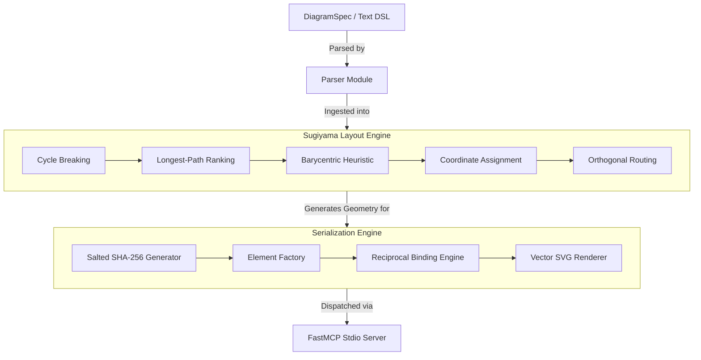

| Field | Value |
|---|---|
| Version | v1.0.0 |
| Last Updated | 2026-10-24 |
| Owner | Lead Technical Writer & Knowledge Architect |
| Status | Approved |

# 📄 Technical Glossary & Domain Vocabulary (Glossary) — Sketchwright

## 1. Domain Vocabulary & Definition Index

To prevent semantic drift, architectural ambiguity, and inconsistent terminology across human developers and AI coding agents, all terms used across the Sketchwright project are formally defined below.

| Term | Context / Scope | Canonical Definition | Forbidden Synonyms / Anti-Patterns |
|---|---|---|---|
| **Barycentric Heuristic** | Layout Engine | A crossing-reduction heuristic in layered graph drawing where nodes on a layer are sorted by the average position (barycenter) of their connected neighbors on adjacent layers. | "Center-averaging", "Node-sorting" |
| **BoundElement** | Excalidraw Engine | An internal Excalidraw relational entry placed inside a shape's `boundElements` array that specifies the `id` and `type` of a bound arrow or text container. | "Child element", "Attached shape" |
| **Container-Text Binding** | Excalidraw Engine | The bi-directional relationship where a container shape (`rectangle`, `ellipse`) owns a text element via `boundElements`, and the text element references the container via `containerId`. | "Text inside box", "Labeling" |
| **Cycle Breaking** | Layout Engine | The initial pass in the Sugiyama framework where feedback edges in a directed graph are identified via Depth-First Search (DFS) and reversed to form a Directed Acyclic Graph (DAG). | "De-looping", "Loop removal" |
| **Deterministic Layout** | Core System | The mathematical property where identical input graphs produce bit-for-bit identical node coordinates, edge routes, and element IDs across multiple runs on different machines. | "Consistent layout", "Static draw" |
| **DiagramSpec** | Data Models | The abstract, geometry-free Pydantic specification representing a system architecture graph before any coordinate calculations or visual rendering occurs. | "Graph JSON", "Raw spec" |
| **Excalidraw Element** | Excalidraw Engine | A discrete geometric primitive in an Excalidraw scene JSON adhering to the official v2 element schema specification. | "Shape object", "Canvas node" |
| **FastMCP** | Interfaces | The high-level Python framework used to implement the Model Context Protocol (MCP) server, managing stdio loops, tool registrations, and schema serialization. | "MCP client", "stdio listener" |
| **Golden Fixture** | Testing | A pre-validated, canonical reference file stored in the test suite against which newly generated outputs are compared to detect visual or geometric regressions. | "Mock data", "Test file" |
| **Longest-Path Ranking** | Layout Engine | The layering pass in Sugiyama drawing where each node is assigned an integer layer index corresponding to the length of the longest path from any source node. | "Tier assignment", "Row numbering" |
| **Model Context Protocol (MCP)** | Interfaces | An open protocol created by Anthropic enabling AI models and agents to discover tools, access context resources, and execute commands via structured JSON-RPC 2.0 messages. | "Agent API", "Claude plugin" |
| **Orthogonal Routing** | Geometry Engine | An edge path calculation technique that connects nodes using strictly horizontal and vertical line segments (stepped polylines) to avoid crossing node centers. | "Square lines", "Right-angle arrows" |
| **Reciprocal Binding** | Excalidraw Engine | An invariant where if Element A points to Element B as a bound child, Element B must simultaneously point back to Element A as its parent container. | "Double link", "Mutual pointer" |
| **Salted SHA-256** | Core Engine | The deterministic hashing algorithm combining diagram title, node ID, and a static repository salt to generate unique, repeatable 20-character element IDs. | "Random UUID", "Hash key" |
| **Stdio Framing** | Protocols | The standard Unix mechanism of using standard input (`stdin`) and standard output (`stdout`) to exchange newline-delimited or Content-Length-prefixed JSON-RPC messages. | "Console output", "CLI stream" |
| **Sugiyama Framework** | Layout Engine | A classical four-phase algorithm for drawing layered directed graphs: (1) Cycle Breaking, (2) Layer Assignment, (3) Crossing Reduction, and (4) Coordinate Assignment. | "Hierarchical layout", "Flowchart engine" |
| **Vector SVG** | Excalidraw Engine | Standalone Scalable Vector Graphics XML document rendered without reliance on browser engines, canvas runtimes, or external raster dependencies. | "Vector image", "SVG file" |

---

## 2. Concept Relationship Map

---

## 3. Related Documents

| Document | Relationship & Cross-Reference |
|---|---|
| [PRD.md](file:///f:/GITHUB/sketchwright-mcp/docs/PRD.md) | Uses domain terms to define product requirements (`REQ-###`). |
| [TechSpec.md](file:///f:/GITHUB/sketchwright-mcp/docs/TechSpec.md) | Technical implementation of concepts defined in this glossary. |
| [AppFlow.md](file:///f:/GITHUB/sketchwright-mcp/docs/AppFlow.md) | Uses glossary terms to describe state transitions and terminal states. |
| [Design.md](file:///f:/GITHUB/sketchwright-mcp/docs/Design.md) | Details visual styling tokens for Excalidraw elements. |
| [Schema.md](file:///f:/GITHUB/sketchwright-mcp/docs/Schema.md) | Implements data entities corresponding to `DiagramSpec` and `ExcalidrawElement`. |
| [ImplementationPlan.md](file:///f:/GITHUB/sketchwright-mcp/docs/ImplementationPlan.md) | Structures development tasks around the core algorithm vocabulary. |
| [Tracker.md](file:///f:/GITHUB/sketchwright-mcp/docs/Tracker.md) | Tracks progress using the terminology defined here. |
| [Rules.md](file:///f:/GITHUB/sketchwright-mcp/docs/Rules.md) | References invariants such as stdio framing and reciprocal bindings. |
| [API.md](file:///f:/GITHUB/sketchwright-mcp/docs/API.md) | Uses glossary terms to document tool inputs, outputs, and JSON-RPC framing. |
| [SecurityAndCompliance.md](file:///f:/GITHUB/sketchwright-mcp/docs/SecurityAndCompliance.md) | References security invariants including zero-network and path sanitization. |
| [Testing.md](file:///f:/GITHUB/sketchwright-mcp/docs/Testing.md) | Defines test fixtures and determinism test cases. |
| [Deployment.md](file:///f:/GITHUB/sketchwright-mcp/docs/Deployment.md) | Explains packaging terminology including sdist, wheel, and PyPI. |
| [RiskRegister.md](file:///f:/GITHUB/sketchwright-mcp/docs/RiskRegister.md) | Documents risks associated with algorithmic edge cases. |
