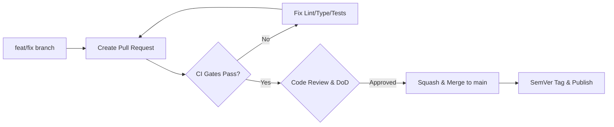

| Field | Value |
|---|---|
| Version | v1.0.0 |
| Last Updated | 2026-10-24 |
| Owner | Principal Architect & Lead Maintainer |
| Status | Approved (Enforced) |

# 📄 Repository Rules & AI Agent Operating Constitution (Rules) — Sketchwright

## 1. Guiding Principles

Every human contributor and autonomous AI coding agent working in this repository must uphold these non-negotiable principles:

1. **`RULE-001` Mathematical Determinism First**: Output coordinates, layout topology, and element IDs must be 100% reproducible. Given identical graph input, output JSON must match bit-for-bit.
2. **`RULE-002` Zero Network Access by Default**: Sketchwright is a local, offline computation engine. It must never initiate network connections, fetch external schemas at runtime, or make background telemetry calls.
3. **`RULE-003` Stdio Protocol Hygiene**: The standard output channel (`stdout`) is reserved strictly for valid JSON-RPC 2.0 frames when running under MCP mode, or intended CLI output data. All logging, diagnostics, warnings, and error stacks must be redirected to `stderr`.
4. **`RULE-004` Explicit Invariants Over Implicit Behavior**: Validate all inputs at the boundary using Pydantic. Reject malformed payloads immediately with descriptive diagnostics rather than silently coercing broken data.
5. **`RULE-005` Atomic, Reversible Commits**: Every change must represent a single logical unit of work. Keep PRs under 400 lines of diff. Never leave the main branch in an unbuildable or broken test state.
6. **`RULE-006` No Secret Ingestion**: Never hardcode credentials, private tokens, or sensitive machine paths. All configuration must resolve via standard flags or clean environment variables.

---

## 2. Code Style & Directory Architecture

### 2.1 Language & Tooling Standards
- **Python Version**: >= 3.12 exclusively.
- **Package Manager**: `uv` (Fast, reproducible dependency locking via `uv.lock`).
- **Linter & Formatter**: `ruff` with 100-character line lengths.
- **Type Checker**: `mypy --strict` with zero permitted untyped definitions in `src/`.
- **Testing Framework**: `pytest` with `pytest-asyncio` and `pytest-cov`.

### 2.2 Canonical Repository Structure

```text
sketchwright-mcp/
├── .github/                      # CI/CD workflows, issue templates, dependabot
│   └── workflows/
│       ├── ci.yml                # Lint, format, type-check, multi-OS test matrix
│       └── release.yml           # PyPI release automation
├── docs/                         # Single source of truth documentation suite, ADRs & guides
│   ├── decisions/                # Architecture Decision Records (ADRs)
│   ├── migration/                # Restructuring audit records and verification runbooks
│   ├── PRD.md                    # Product Requirements Document
│   ├── TechSpec.md               # Technical Specification & Architecture
│   ├── AppFlow.md                # Application Flow & UI State Inventory
│   ├── Design.md                 # Design System & Excalidraw Visual Tokens
│   ├── Schema.md                 # Data Models & Canonical Diagram Schemas
│   ├── ImplementationPlan.md     # Phased Implementation & Build Sequencing
│   ├── Tracker.md                # Living Project Status & Task Tracker
│   ├── Rules.md                  # Repository Constitution & AI Agent Rules
│   ├── API.md                    # FastMCP Tool Signatures & CLI Interfaces
│   ├── SecurityAndCompliance.md  # Threat Model & Security Sandboxing
│   ├── Testing.md                # QA Strategy, Test Cases & Fixtures
│   ├── Deployment.md             # Release Automation & Client Configs
│   ├── Glossary.md               # Technical Terms & Domain Vocabulary
│   ├── RiskRegister.md           # Operational Risk Matrix & Mitigations
│   ├── configuration.md          # Environment Variables & Settings Reference
│   └── troubleshooting.md        # Diagnostic Procedures & Troubleshooting FAQ
├── examples/                     # Sample input specs and MCP client configurations
├── src/                          # Canonical Python source tree (PEP 517/518)
│   └── sketchwright/
│       ├── __init__.py           # Package version and public exports
│       ├── main.py               # Unified CLI entry point (Typer/Click)
│       ├── mcp_server.py         # FastMCP stdio server implementation
│       ├── py.typed              # PEP 561 typing marker
│       ├── engine/               # Layout algorithms & geometry
│       │   ├── algorithms.py     # Sugiyama, grid, tree layout implementations
│       │   ├── geometry.py       # Box collisions, point math, and padding
│       │   └── routing.py        # Stepped orthogonal polyline edge routing
│       ├── excalidraw/           # Excalidraw schema & serialization
│       │   ├── models.py         # Excalidraw element data models
│       │   ├── serializer.py     # Deterministic scene graph serializer
│       │   ├── svg.py            # Pure vector SVG rendering engine
│       │   └── validator.py      # Scene integrity & reciprocal binding validator
│       ├── models/               # Abstract diagram specification models
│       │   ├── config.py         # Layout and style configuration schemas
│       │   └── diagram.py        # DiagramSpec, NodeSpec, EdgeSpec, GroupSpec
│       └── parser/               # Input format processors
│           ├── structured.py     # Structured JSON / YAML parser
│           └── text.py           # Shorthand line-based DSL parser
└── tests/                        # Comprehensive automated test suite
    ├── conftest.py               # Shared pytest fixtures and sample graphs
    ├── contract/                 # MCP protocol interface schema and contract test suite
    ├── e2e/                      # Live subprocess MCP stdio client-server integration tests
    ├── fixtures/                 # Reusable valid/invalid graph JSON fixtures
    ├── integration/              # Multi-component pipeline and geometric determinism tests
    └── unit/                     # Fast component unit tests covering layout, models, CLI, and serializer
```

---

## 3. Git Workflow & Review Standards



### 3.1 Branching & Commit Conventions
- **Branch Naming**:
  - Features: `feat/<issue-id>-short-description`
  - Fixes: `fix/<issue-id>-short-description`
  - Chores / Docs: `chore/<description>` or `docs/<description>`
- **Commit Messages**: Enforce [Conventional Commits](https://www.conventionalcommits.org/):
  - `feat: add orthogonal stepped edge router for cyclic graphs`
  - `fix: prevent container text overflow on multi-line labels`
  - `docs: update Schema.md entity tables with group constraints`
  - `test: add fuzz tests for 1MB JSON input payloads`

### 3.2 Pull Request Criteria
- Maximum lines of diff: **400 LOC** (excluding generated lockfiles or test assets).
- 100% CI checks passing (Ruff, Mypy strict, multi-OS pytest).
- No force-pushes to `main`. All merges squashed with clean commit history.

---

## 4. Testing & Quality Requirements

- **`RULE-007` Coverage Threshold**: Maintain repository test coverage above **90%** at all times.
- **`RULE-008` Deterministic Regression Tests**: Any change affecting `engine/` or `excalidraw/` must include a test asserting bit-for-bit output reproducibility across consecutive runs.
- **`RULE-009` Collision Verification**: Every new layout feature must pass the automated bounding-box collision detection suite ensuring zero overlapping nodes.
- **`RULE-010` Stdio Leak Detection**: MCP unit tests must capture and assert that `sys.stdout` receives zero unformatted log statements during tool execution.

---

## 5. AI Agent Operating Constitution

When an autonomous AI agent (e.g., Claude, Cursor, Windsurf) operates in this repository, it MUST adhere to the following imperative rules:

1. **`AGT-001` Consult the Living Documents First**: Always review [Tracker.md](file:///f:/GITHUB/sketchwright-mcp/docs/Tracker.md) and [ImplementationPlan.md](file:///f:/GITHUB/sketchwright-mcp/docs/ImplementationPlan.md) prior to beginning any code modification.
2. **`AGT-002` Never Mark Done Without Passing Tests**: Never flip a task status to `🟢 Done` in `Tracker.md` until `uv run pytest` executes with 100% success and zero regressions.
3. **`AGT-003` Zero Assumption Policy**: Never invent undocumented CLI arguments, schema fields, or protocol behavior. If a user request is ambiguous, stop and ask for clarification or propose a structured choice.
4. **`AGT-004` Synchronized Documentation**: Any change that modifies a data structure in `src/sketchwright/models/` or an Excalidraw element property in `src/sketchwright/excalidraw/` MUST be accompanied by a same-commit update to [Schema.md](file:///f:/GITHUB/sketchwright-mcp/docs/Schema.md).
5. **`AGT-005` Never Suppress Type Safety**: Never add `# type: ignore` or `# noqa` simply to pass CI. Fix the underlying type signature or refactor the offending expression.
6. **`AGT-006` Zero Stdio Pollution**: Never insert `print()` statements for debugging into `src/sketchwright/mcp_server.py` or underlying engine modules. Use `logging.getLogger(__name__)` configured to output strictly to `stderr`.

---

## 6. Security Baseline Rules

- **Input Size Ceilings**: JSON and DSL inputs parsed via CLI or MCP are capped at **1 MB** (1,048,576 bytes) to defend against memory exhaustion and regex ReDoS attacks.
- **Graph Complexity Limits**: Layout engine rejects input specifications exceeding **500 nodes** or **1,000 edges** per diagram.
- **Path Traversal Defense**: All output file writing must sanitize target paths using `os.path.realpath`, verifying that destination directories are writable and within intended scratch/target workspaces.
- **Dependency Sandboxing**: Run zero unpinned dependencies; lockfiles must be audited via automated security scanning (`dependabot.yml` and `secret-scan.yml`).

---

## 7. Prohibited Anti-Patterns

| Anti-Pattern ID | Prohibited Pattern | Reason / Consequence |
|---|---|---|
| `ANTI-001` | Raw `print()` to `stdout` in core library | Corrupts JSON-RPC 2.0 framing, causing AI host agents to disconnect |
| `ANTI-002` | Unseeded or non-deterministic random IDs (`uuid.uuid4()`) | Breaks diagram determinism; causes massive unnecessary Git diffs |
| `ANTI-003` | Importing external HTTP libraries (`requests`, `httpx`) | Violates zero-network architectural invariant (`RULE-002`) |
| `ANTI-004` | Hardcoded absolute paths in test fixtures | Breaks CI matrix runs on Windows, Linux, and macOS runners |
| `ANTI-005` | Floating text elements without container bindings | Causes unlinked labels to detach when diagrams are manipulated in Excalidraw |

---

## 8. Escalation & Autonomous Authority Matrix

| Action / Decision | Autonomous AI Decision | Requires Human Approval |
|---|:---:|:---:|
| Refactoring internal layout algorithms without changing public API | ✅ | |
| Adding unit and integration tests | ✅ | |
| Updating `docs/Tracker.md` following successful test execution | ✅ | |
| Adding new internal helper functions or data models | ✅ | |
| Modifying public CLI commands or flags | | 🛑 Human Approval Required |
| Introducing a new external PyPI dependency | | 🛑 Human Approval Required |
| Changing public MCP tool names or parameters | | 🛑 Human Approval Required |
| Deleting existing public API endpoints or models | | 🛑 Human Approval Required |

---

## 9. Related Documents

| Document | Relationship & Cross-Reference |
|---|---|
| [PRD.md](file:///f:/GITHUB/sketchwright-mcp/docs/PRD.md) | Defines system goals (`G-###`) and user stories (`US-###`) enforced by these rules. |
| [TechSpec.md](file:///f:/GITHUB/sketchwright-mcp/docs/TechSpec.md) | Documents architectural boundaries and module contracts governed by this constitution. |
| [AppFlow.md](file:///f:/GITHUB/sketchwright-mcp/docs/AppFlow.md) | Specifies UI states and error diagnostics enforced in Section 1. |
| [Design.md](file:///f:/GITHUB/sketchwright-mcp/docs/Design.md) | Enforces visual styling tokens and accessibility standards for generated elements. |
| [Schema.md](file:///f:/GITHUB/sketchwright-mcp/docs/Schema.md) | Provides the data schema that must be synchronized upon any model modification. |
| [ImplementationPlan.md](file:///f:/GITHUB/sketchwright-mcp/docs/ImplementationPlan.md) | Establishes the phased task list that AI agents must consult before starting work. |
| [Tracker.md](file:///f:/GITHUB/sketchwright-mcp/docs/Tracker.md) | Living status tracker updated in compliance with `AGT-002`. |
| [API.md](file:///f:/GITHUB/sketchwright-mcp/docs/API.md) | Defines the contract interfaces protected by escalation rules. |
| [SecurityAndCompliance.md](file:///f:/GITHUB/sketchwright-mcp/docs/SecurityAndCompliance.md) | Expands upon the security baseline rules defined in Section 6. |
| [Testing.md](file:///f:/GITHUB/sketchwright-mcp/docs/Testing.md) | Details the test suites and coverage requirements mandated by `RULE-007`. |
| [Deployment.md](file:///f:/GITHUB/sketchwright-mcp/docs/Deployment.md) | Outlines release and CI/CD operations governed by Section 3. |
| [Glossary.md](file:///f:/GITHUB/sketchwright-mcp/docs/Glossary.md) | Defines terminology referenced throughout these rules. |
| [RiskRegister.md](file:///f:/GITHUB/sketchwright-mcp/docs/RiskRegister.md) | Documents risks associated with violating repository invariants. |
