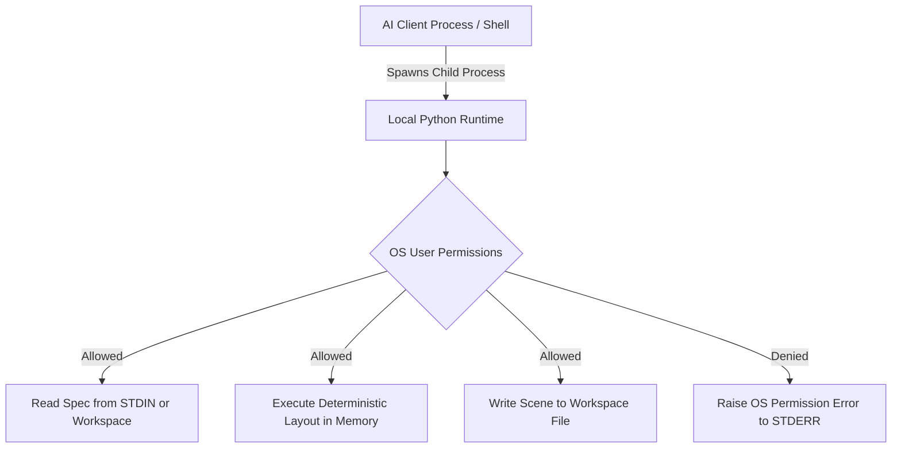

| Field | Value |
|---|---|
| Version | v1.0.0 |
| Last Updated | 2026-10-24 |
| Owner | Lead Security & Compliance Architect |
| Status | Approved |

# 📄 Security Architecture & Defensive Boundaries (SecurityAndCompliance) — Sketchwright

## 1. Executive Security Posture
Sketchwright operates exclusively as a **local, offline computational utility** designed for developer environments and AI coding agents. Because it executes within the invoking user's local security context over stdio or local CLI invocations, its security posture focuses on:
1. **Preventing Local File Overwrites & Path Traversal (CWE-22)**
2. **Defending Against Algorithmic & Memory Exhaustion (Denial of Service)**
3. **Eliminating Unintended Network Exfiltration (Zero-Network Invariant)**
4. **Supply Chain Integrity and Dependency Pinning**

---

## 2. STRIDE Threat Model

| Threat Category | Threat ID | Specific Vector / Scenario | Inherent Risk | Architectural Mitigation & Defense | Residual Risk |
|---|---|---|:---:|---|:---:|
| **Spoofing** | `THR-001` | Malicious actor attempts to forge MCP JSON-RPC messages | Low | MCP communicates over local standard OS pipes (`stdin`/`stdout`). Only the spawning parent process has IPC pipe access. | Negligible |
| **Tampering** | `THR-002` | Spec payload injects `../` path traversal to overwrite critical system files | **High** | Path sanitization enforces absolute canonical paths (`os.path.realpath`) and verifies parent directory write permissions. | Low |
| **Repudiation** | `THR-003` | Host process denies executing or requesting diagram modifications | Low | All executions and file writes emit structured log lines to `stderr` with timestamps and hashes. | Negligible |
| **Information Disclosure** | `THR-004` | Diagram generation inadvertently leaks environment secrets into Excalidraw files | Medium | Zero network access; diagrams are built solely from passed input payloads. Serializer never reads OS environment variables. | Low |
| **Denial of Service** | `THR-005` | Massive JSON (100MB+) or deeply cyclic graph causes RAM exhaustion or infinite loops | **High** | Hard input payload ceiling of 1 MB; DFS recursion limit of 500 nodes; timeout guards on crossing reduction passes. | Low |
| **Elevation of Privilege** | `THR-006` | Attacker passes shell metacharacters in CLI arguments to achieve RCE | **High** | Zero usage of `shell=True` or `eval()`. CLI parser (Typer/Click) strictly enforces typed arguments and flags. | Negligible |

---

## 3. Defensive Boundaries & Concrete Limits

### 3.1 Resource & DoS Limits
To defend against denial-of-service via memory exhaustion or CPU hangs:
- **Max Input Payload (`SKETCHWRIGHT_MAX_INPUT_BYTES`)**: Default `1,048,576` (1 MB). Strings exceeding this threshold are rejected immediately before JSON decoding with `413 Payload Too Large`.
- **Max Node Count (`SKETCHWRIGHT_MAX_NODES`)**: Default `500` nodes per diagram.
- **Max Edge Count (`SKETCHWRIGHT_MAX_EDGES`)**: Default `1,000` edges per diagram.
- **Max Label Length (`SKETCHWRIGHT_MAX_LABEL_LENGTH`)**: Default `256` characters per label.
- **Numeric Verification**: All coordinates and dimensions must be finite numbers; `NaN`, `+inf`, and `-inf` are rejected.

### 3.2 Filesystem Protection & Atomic Writes
When writing diagram files (`.excalidraw` or `.svg`):
- **Path Resolution & Normalization**: User-supplied paths are resolved to absolute paths via `os.path.realpath`. Traversal patterns (`../`) are validated to ensure writes occur strictly within designated directories (`SKETCHWRIGHT_ALLOWED_DIR` if set).
- **Atomic File Writing**: Output is written to a hidden temporary file with a random UUID suffix in the destination directory, flushed to disk, synced via `os.fsync`, and atomically replaced via `os.replace`. This eliminates race conditions and partially written files.
- **Overwrite Protection**: Destination files are never overwritten silently; explicit permission (`--overwrite` flag or `overwrite=True` parameter) is mandatory.

### 3.3 Execution Safety & Sandboxing
- **No Dynamic Evaluation**: Sketchwright contains zero calls to `eval()`, `exec()`, or `__import__()`.
- **No Subprocess Invocations from Diagram Content**: Diagram metadata cannot trigger shell commands or external scripts.
- **No Unsolicited Network Calls**: The core library operates 100% offline and makes zero telemetry or update requests.

### 3.4 Transport Isolation
- MCP JSON-RPC frames over `stdio` strictly utilize `sys.stdout`.
- Internal logging is redirected to `sys.stderr` to prevent protocol framing corruption.
- Sensitive environment variables and secrets are never reflected in error payloads.

---

## 4. Authentication & Authorization Model

- **Authentication**: Sketchwright requires **zero credentials, API tokens, or external identity providers**. Authentication is implicitly inherited from the host operating system user executing the process.
- **Authorization**: File creation and modification permissions are strictly bounded by the host OS user's DAC (Discretionary Access Control) permissions. Sketchwright does not escalate privileges.

---

## 5. Data Classification & Privacy

| Data Type | Classification | Storage Location | Retention Policy | Protection Mechanism |
|---|---|---|---|---|
| **Diagram Specs** (JSON / DSL) | Internal / Public | Memory / Local disk | Ephemeral | Loaded in RAM during layout; discarded on process exit |
| **Excalidraw Scenes** (`.excalidraw`) | Internal / User Data | Local workspace | Governed by user | Standard OS file permissions |
| **Vector Graphics** (`.svg`) | Internal / User Data | Local workspace | Governed by user | Standard OS file permissions |
| **Telemetry / Analytics** | **None** | N/A | Zero collection | No analytics or telemetry code exists in the codebase |
| **Credentials / Secrets** | **Prohibited** | N/A | Never ingested | Automated secret scanner (`secret-scan.yml`) blocks PRs |

---

## 6. Incident Response & Vulnerability Disclosure

If a security vulnerability or unexpected privilege escalation vector is discovered:
1. **Reporting**: Send details to `security@sketchwright.internal` or open a GitHub Security Advisory (do not file public issues).
2. **Triaging SLA**: Initial assessment and confirmation within 48 hours.
3. **Patch & Release SLA**: Critical patches released within 7 calendar days under a SemVer patch release.
4. **Post-Mortem**: Publish root-cause analysis and remediation steps in repository advisories.

---

## 7. Related Documents

| Document | Relationship & Cross-Reference |
|---|---|
| [PRD.md](file:///f:/GITHUB/sketchwright-mcp/docs/PRD.md) | Defines the zero-network and security invariants (`MET-005`). |
| [TechSpec.md](file:///f:/GITHUB/sketchwright-mcp/docs/TechSpec.md) | Details the technical implementation of input sanitizers and memory guards. |
| [AppFlow.md](file:///f:/GITHUB/sketchwright-mcp/docs/AppFlow.md) | Details error handling and diagnostic routing (`SCR-007`). |
| [Design.md](file:///f:/GITHUB/sketchwright-mcp/docs/Design.md) | Governs secure handling of styling tokens without script injection. |
| [Schema.md](file:///f:/GITHUB/sketchwright-mcp/docs/Schema.md) | Defines field-level constraints and validation limits on all models. |
| [ImplementationPlan.md](file:///f:/GITHUB/sketchwright-mcp/docs/ImplementationPlan.md) | Tracks execution of security fuzzing tasks (`TASK-4.2`). |
| [Tracker.md](file:///f:/GITHUB/sketchwright-mcp/docs/Tracker.md) | Tracks the active status of security verification tasks. |
| [Rules.md](file:///f:/GITHUB/sketchwright-mcp/docs/Rules.md) | Enforces the security baseline rules and prohibited patterns. |
| [API.md](file:///f:/GITHUB/sketchwright-mcp/docs/API.md) | Documents API error codes related to security boundaries. |
| [Testing.md](file:///f:/GITHUB/sketchwright-mcp/docs/Testing.md) | Specifies fuzz testing and path traversal test cases. |
| [Deployment.md](file:///f:/GITHUB/sketchwright-mcp/docs/Deployment.md) | Outlines supply chain security and GitHub Actions release verification. |
| [Glossary.md](file:///f:/GITHUB/sketchwright-mcp/docs/Glossary.md) | Defines security terms like STRIDE, CWE-22, and ReDoS. |
| [RiskRegister.md](file:///f:/GITHUB/sketchwright-mcp/docs/RiskRegister.md) | Tracks security threats and architectural mitigations. |
