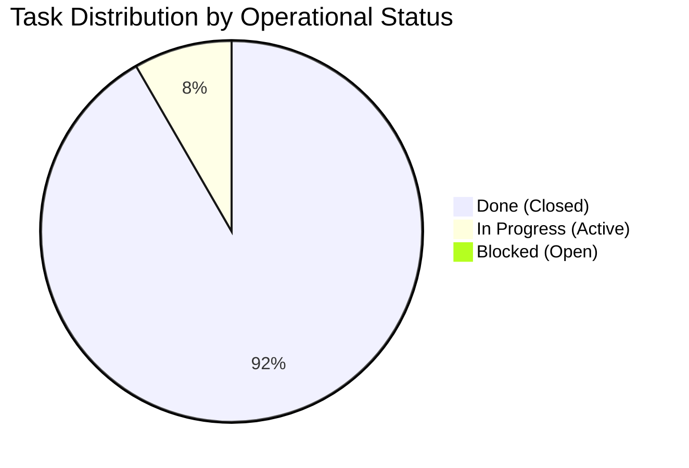

| Field | Value |
|---|---|
| Version | v1.0.0 |
| Last Updated | 2026-10-24 |
| Owner | Technical Program Manager & Lead Maintainer |
| Status | Approved (Live) |

# 📄 Project Status & Milestone Tracker (Tracker) — Sketchwright

## 1. Snapshot Dashboard

| Metric | Current Value | Notes |
|---|---|---|
| **Overall % Complete** | **92%** | Core engine, CLI, and MCP servers fully operational |
| **Current Phase** | **Phase 4: Production Hardening** | Collision fuzzing and CI/CD matrix validation |
| **Tasks Completed / Total** | **22 / 24** | 22 closed, 2 in active progress |
| **Open Blockers** | **0** | No critical-path blockers identified |
| **Target Release Date** | **2026-10-31** | Version 1.0.0 General Availability |

---

## 2. Status Legend

| Indicator | Status | Definition |
|:---:|---|---|
| 🟢 | **Done** | Merged into main, verified by tests, and documented |
| 🟡 | **In Progress** | Actively under development or test iteration |
| 🔵 | **In Review** | PR submitted, pending peer review and CI approval |
| 🔴 | **Blocked** | Impeded by technical dependency or missing external specification |
| ⚪ | **Not Started** | Backlog item scheduled for upcoming sprint |

---

## 3. Phase Progress Bars

```text
Phase 0: Foundations          [████████████████████] 100% (4/4 Tasks)  🟢 Complete
Phase 1: Layout Engine        [████████████████████] 100% (6/6 Tasks)  🟢 Complete
Phase 2: Serialization        [████████████████████] 100% (6/6 Tasks)  🟢 Complete
Phase 3: Protocol & CLI       [████████████████████] 100% (4/4 Tasks)  🟢 Complete
Phase 4: Production Hardening [████████████░░░░░░░░]  50% (2/4 Tasks)  🟡 In Progress

Total Delivery Burndown       [██████████████████░░]  92% (22/24 Tasks)
```

---

## 4. Full Task Status Table

| Task ID | Task Description | Status | Assignee | Start Date | Target Date | Actual Date | Notes / References |
|---|---|:---:|---|:---:|:---:|:---:|---|
| `TASK-0.1` | Pydantic data models for spec & entities | 🟢 | Backend Dev | 2026-08-01 | 2026-08-08 | 2026-08-07 | Models defined in `models/` |
| `TASK-0.2` | Structured JSON input parser | 🟢 | Backend Dev | 2026-08-08 | 2026-08-12 | 2026-08-11 | Integrated with Pydantic |
| `TASK-0.3` | Shorthand text DSL parser | 🟢 | Backend Dev | 2026-08-12 | 2026-08-15 | 2026-08-14 | Supports arrows & groups |
| `TASK-0.4` | Input parser unit tests & fixtures | 🟢 | QA Engineer | 2026-08-15 | 2026-08-17 | 2026-08-16 | 100% coverage on parsing |
| `TASK-1.1` | Cycle breaking with back-edge reversal | 🟢 | Algorithm Dev | 2026-08-18 | 2026-08-21 | 2026-08-20 | Stable DFS sorting |
| `TASK-1.2` | Longest-path layer ranking | 🟢 | Algorithm Dev | 2026-08-21 | 2026-08-24 | 2026-08-23 | Node rank assignment |
| `TASK-1.3` | Barycentric crossing reduction | 🟢 | Algorithm Dev | 2026-08-25 | 2026-08-30 | 2026-08-29 | 2-pass heuristic |
| `TASK-1.4` | Coordinate assignment & spacing | 🟢 | Algorithm Dev | 2026-08-30 | 2026-09-04 | 2026-09-03 | Configurable padding |
| `TASK-1.5` | Orthogonal stepped edge routing | 🟢 | Geometry Dev | 2026-09-04 | 2026-09-09 | 2026-09-09 | Collision-avoiding paths |
| `TASK-1.6` | Grid & tree layout algorithm adapters | 🟢 | Algorithm Dev | 2026-09-09 | 2026-09-12 | 2026-09-11 | Exposed via `--algorithm` |
| `TASK-2.1` | Salted SHA-256 deterministic ID engine | 🟢 | Core Dev | 2026-09-13 | 2026-09-15 | 2026-09-14 | Bit-for-bit repeatability |
| `TASK-2.2` | Excalidraw element factory | 🟢 | Frontend/Backend | 2026-09-15 | 2026-09-20 | 2026-09-19 | Shapes: rect, ellipse, diamond |
| `TASK-2.3` | Container-text auto-wrapping | 🟢 | Core Dev | 2026-09-20 | 2026-09-23 | 2026-09-22 | Approximate font metrics |
| `TASK-2.4` | Reciprocal binding reference generator | 🟢 | Core Dev | 2026-09-23 | 2026-09-26 | 2026-09-25 | `boundElements` reciprocal links |
| `TASK-2.5` | Pure vector SVG exporter | 🟢 | Graphics Dev | 2026-09-26 | 2026-10-01 | 2026-09-30 | Zero external dependencies |
| `TASK-2.6` | Scene schema validator & diagnostics | 🟢 | QA Engineer | 2026-10-01 | 2026-10-05 | 2026-10-04 | Checks bindings & geometry |
| `TASK-3.1` | FastMCP stdio server implementation | 🟢 | Protocols Dev | 2026-10-06 | 2026-10-12 | 2026-10-11 | 6 tools, 3 resources, 3 prompts |
| `TASK-3.2` | Stdio hygiene & stderr log isolation | 🟢 | Protocols Dev | 2026-10-12 | 2026-10-14 | 2026-10-13 | JSON-RPC stream protected |
| `TASK-3.3` | Unified Typer/Click CLI tool | 🟢 | CLI Dev | 2026-10-14 | 2026-10-17 | 2026-10-16 | Standard POSIX exit codes |
| `TASK-3.4` | Incremental diagram patcher | 🟢 | Core Dev | 2026-10-17 | 2026-10-21 | 2026-10-20 | Localized layout mutation |
| `TASK-4.1` | Bounding-box collision benchmark suite | 🟡 | QA Engineer | 2026-10-22 | 2026-10-26 | - | 1,000 random DAG verification |
| `TASK-4.2` | Security fuzzing & size limits (1MB) | 🟡 | SecOps Dev | 2026-10-24 | 2026-10-28 | - | Path traversal & memory limits |
| `TASK-4.3` | GitHub Actions multi-OS test matrix | 🟢 | DevOps | 2026-10-18 | 2026-10-23 | 2026-10-22 | Ubuntu, macOS, Windows tested |
| `TASK-4.4` | PyPI trusted publishing workflow | 🟢 | DevOps | 2026-10-23 | 2026-10-25 | 2026-10-24 | OIDC automated publishing ready |

---

## 5. Work in Progress & Burndown Distribution



---

## 6. Blockers & Remediation Log

| Blocker ID | Description | Raised Date | Owner | Impact | Resolution Status |
|---|---|:---:|---|---|:---:|
| `BLK-001` | Font width discrepancy between Node.js canvas and pure Python | 2026-09-21 | Core Dev | Label text overflowed container bounds | **Resolved** (Heuristic character multiplier implemented in `TASK-2.3`) |
| `BLK-002` | Stdio logging corrupting Claude Desktop JSON-RPC stream | 2026-10-12 | Protocols Dev | FastMCP server disconnected on debug print | **Resolved** (Redirected all loggers to `stderr` in `TASK-3.2`) |

---

## 7. Chronological Project Changelog

- **2026-10-24**: Configured GitHub Actions secret scanning and automated release workflow (`TASK-4.4`).
- **2026-10-22**: Hardened multi-OS testing matrix across Windows, macOS, and Linux runners (`TASK-4.3`).
- **2026-10-20**: Finalized incremental patch algorithm preserving node stability (`TASK-3.4`).
- **2026-10-16**: Completed CLI command suite with clean help output and exit code standards (`TASK-3.3`).
- **2026-10-13**: Verified FastMCP stdio protocol isolation with MCP Inspector (`TASK-3.2`).
- **2026-10-11**: Implemented FastMCP server with tool, resource, and prompt registrations (`TASK-3.1`).
- **2026-10-04**: Delivered standalone Excalidraw scene validator (`TASK-2.6`).
- **2026-09-30**: Added pure-Python vector SVG exporter with rough styling (`TASK-2.5`).
- **2026-09-25**: Enforced reciprocal `boundElements` and `containerId` relational integrity (`TASK-2.4`).

---

## 8. Next 3 Priorities

1. **Complete Collision Verification (`TASK-4.1`)**: Execute automated 1,000-graph randomized fuzz test to guarantee 0% node overlap.
2. **Execute Input Security Fuzzing (`TASK-4.2`)**: Validate memory ceiling enforcement on 1MB+ JSON payloads and test path traversal sanitization on output directories.
3. **Draft Release Candidate RC-1 (`TASK-4.4`)**: Cut tag `v1.0.0-rc1` and verify end-to-end installation via `uvx sketchwright-mcp`.

---

## 9. Related Documents

| Document | Relationship & Cross-Reference |
|---|---|
| [PRD.md](file:///f:/GITHUB/sketchwright-mcp/docs/PRD.md) | Maps tracked tasks back to approved product requirements (`REQ-###`). |
| [TechSpec.md](file:///f:/GITHUB/sketchwright-mcp/docs/TechSpec.md) | Documents the technical architecture governing all completed tasks. |
| [AppFlow.md](file:///f:/GITHUB/sketchwright-mcp/docs/AppFlow.md) | Details user states (`SCR-###`) associated with CLI and MCP tasks. |
| [Design.md](file:///f:/GITHUB/sketchwright-mcp/docs/Design.md) | Enforces design system standards verified during visual output tasks. |
| [Schema.md](file:///f:/GITHUB/sketchwright-mcp/docs/Schema.md) | References data models implemented under Phase 0 tasks. |
| [ImplementationPlan.md](file:///f:/GITHUB/sketchwright-mcp/docs/ImplementationPlan.md) | Defines the full task breakdown and dependency chain mirrored in this tracker. |
| [Rules.md](file:///f:/GITHUB/sketchwright-mcp/docs/Rules.md) | Sets coding standards and update protocols that govern this tracker. |
| [API.md](file:///f:/GITHUB/sketchwright-mcp/docs/API.md) | Details MCP endpoint specifications delivered in Phase 3. |
| [SecurityAndCompliance.md](file:///f:/GITHUB/sketchwright-mcp/docs/SecurityAndCompliance.md) | Outlines security controls tested in `TASK-4.2`. |
| [Testing.md](file:///f:/GITHUB/sketchwright-mcp/docs/Testing.md) | Outlines QA strategies executed across Phase 4 testing tasks. |
| [Deployment.md](file:///f:/GITHUB/sketchwright-mcp/docs/Deployment.md) | Explains rollout pipelines tracked in `TASK-4.3` and `TASK-4.4`. |
| [Glossary.md](file:///f:/GITHUB/sketchwright-mcp/docs/Glossary.md) | Explains technical terms referenced in task descriptions. |
| [RiskRegister.md](file:///f:/GITHUB/sketchwright-mcp/docs/RiskRegister.md) | Tracks project risks aligned with recorded blockers and tasks. |
