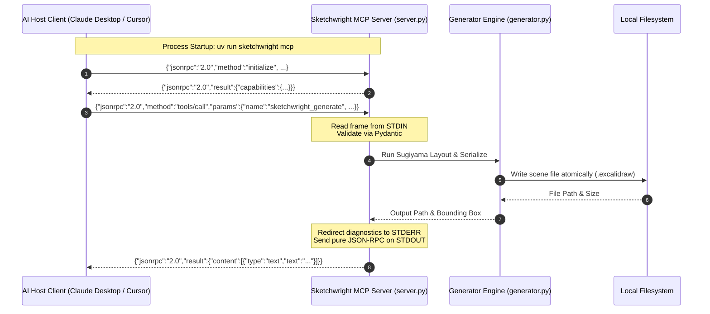

| Field | Value |
|---|---|
| Version | v1.0.0 |
| Last Updated | 2026-10-24 |
| Owner | Principal Protocols Architect |
| Status | Approved |

# 📄 Interface & API Specification (API) — Sketchwright

## 1. Overview & Interface Contracts
Sketchwright exposes two primary programmatic interface surfaces:
1. **Model Context Protocol (MCP) Stdio Server**: JSON-RPC 2.0 frames over `stdin`/`stdout` communicating with AI clients (Claude Desktop, Cursor, Google Antigravity).
2. **POSIX CLI Interface**: Terminal command-line entry points designed for developer scripting and CI/CD pipelines.

---

## 2. Model Context Protocol (MCP) Integration

### 2.1 Stdio Protocol Flow & Sequence


### 2.2 Host Client Setup Configurations

#### Claude Desktop Configuration
Add the server definition to `%APPDATA%\Claude\claude_desktop_config.json` (Windows) or `~/Library/Application Support/Claude/claude_desktop_config.json` (macOS):

```json
{
  "mcpServers": {
    "sketchwright": {
      "command": "uv",
      "args": [
        "run",
        "--directory",
        "<path-to-sketchwright-mcp>",
        "sketchwright",
        "mcp"
      ]
    }
  }
}
```

#### Google Antigravity / Cursor Configuration
Add to `.agents/mcp_config.json` or Cursor MCP settings:

```json
{
  "mcpServers": {
    "sketchwright": {
      "command": "uv",
      "args": [
        "run",
        "--directory",
        "<path-to-sketchwright-mcp>",
        "sketchwright",
        "mcp"
      ]
    }
  }
}
```

---

## 3. MCP Tool Inventory & Endpoint Specifications

### 3.1 Tool Inventory

| Tool Name | Tool ID | Description | Primary Parameters | Output Type |
|---|---|---|---|---|
| `sketchwright_generate` | `EP-001` | Generates a complete Excalidraw scene from a graph spec or text DSL | `spec` (object/string), `output_path` (str), `format` (enum) | JSON-RPC Text (File Path & Summary) |
| `sketchwright_layout` | `EP-002` | Calculates 2D bounding-box coordinates for nodes without serializing to Excalidraw | `spec` (object), `algorithm` (str), `direction` (str) | JSON-RPC Object (Position Map) |
| `sketchwright_validate` | `EP-003` | Validates an existing `.excalidraw` file for structural and binding integrity | `file_path` (str) | JSON-RPC Object (Validation Report) |
| `sketchwright_update` | `EP-004` | Incrementally patches an existing `.excalidraw` diagram with node/edge updates | `file_path` (str), `patch` (object) | JSON-RPC Text (Updated File Path) |
| `sketchwright_capabilities` | `EP-005` | Returns runtime server metadata, supported algorithms, shapes, and fonts | None | JSON-RPC Object (Capabilities Schema) |
| `sketchwright_export_svg` | `EP-006` | Exports an existing `.excalidraw` scene or spec into a standalone `.svg` vector file | `source` (str), `output_path` (str) | JSON-RPC Text (SVG File Path) |

---

### 3.2 Tool Endpoint Specifications

#### `EP-001`: `sketchwright_generate`
- **Method**: MCP Tool Call
- **Authentication**: Local process execution context (zero external credentials)
- **Request Schema**:
```json
{
  "type": "object",
  "properties": {
    "spec": {
      "type": ["object", "string"],
      "description": "Valid DiagramSpec JSON object or shorthand line-based DSL string"
    },
    "output_path": {
      "type": "string",
      "description": "Target filesystem path (e.g., 'architecture.excalidraw')"
    },
    "format": {
      "type": "string",
      "enum": ["excalidraw", "svg"],
      "default": "excalidraw",
      "description": "Output serialization format"
    }
  },
  "required": ["spec", "output_path"]
}
```
- **Response Schema**:
```json
{
  "file_path": "f:/GITHUB/sketchwright-mcp/architecture.excalidraw",
  "nodes_count": 12,
  "edges_count": 15,
  "bounding_box": {
    "width": 1420.0,
    "height": 840.0
  },
  "status": "success"
}
```

#### `EP-003`: `sketchwright_validate`
- **Method**: MCP Tool Call
- **Request Schema**:
```json
{
  "type": "object",
  "properties": {
    "file_path": {
      "type": "string",
      "description": "Absolute or workspace-relative path to .excalidraw file"
    }
  },
  "required": ["file_path"]
}
```
- **Response Schema**:
```json
{
  "valid": true,
  "elements_count": 28,
  "version": 2,
  "orphan_bindings": [],
  "errors": [],
  "warnings": []
}
```

---

## 4. MCP Resources & Prompts

### 4.1 Exposed Resources
- `sketchwright://capabilities` (`RES-001`): Static JSON document detailing supported shapes, algorithms, and layout directions.
- `sketchwright://schemas/diagram` (`RES-002`): Complete JSON Schema for `DiagramSpec`.
- `sketchwright://examples/architecture` (`RES-003`): Reference microservices architecture diagram spec.

### 4.2 Registered Prompts
- `sketchwright_system_architecture` (`PRM-001`): Prompt template guiding the LLM to structure a multi-tier microservices graph.
- `sketchwright_flowchart` (`PRM-002`): Prompt template for conditional workflow and state machine diagrams.
- `sketchwright_sequence_diagram` (`PRM-003`): Prompt template mapping sequence interactions into layered graph specifications.

---

## 5. Command-Line Interface (CLI) Specifications

All CLI commands exit with standard POSIX codes:
- `0`: Success
- `1`: Validation or algorithmic error
- `2`: CLI usage syntax error / missing argument

| Command | Command ID | Arguments & Flags | Description |
|---|---|---|---|
| `sketchwright generate` | `CLI-001` | `<input_spec> -o <output_file> [--algorithm sugiyama] [--format excalidraw]` | Compiles a spec file into a diagram |
| `sketchwright layout` | `CLI-002` | `<input_spec> [--format json]` | Outputs 2D node coordinates to stdout |
| `sketchwright validate` | `CLI-003` | `<scene_file>` | Validates Excalidraw scene geometry and reciprocal bindings |
| `sketchwright capabilities` | `CLI-004` | `[--json]` | Prints engine capabilities and available layout algorithms |
| `sketchwright mcp` | `CLI-005` | None | Starts the FastMCP JSON-RPC stdio server listener |

---

## 6. Related Documents

| Document | Relationship & Cross-Reference |
|---|---|
| [PRD.md](file:///f:/GITHUB/sketchwright-mcp/docs/product/PRD.md) | Maps API endpoints to user stories (`US-001`, `US-002`) and requirements (`REQ-009`, `REQ-010`). |
| [TechSpec.md](file:///f:/GITHUB/sketchwright-mcp/docs/architecture/TechSpec.md) | Describes the internal handler architecture implementing these endpoints. |
| [AppFlow.md](file:///f:/GITHUB/sketchwright-mcp/docs/product/AppFlow.md) | Maps CLI endpoints to screens and state transitions (`SCR-001` through `SCR-007`). |
| [Design.md](file:///f:/GITHUB/sketchwright-mcp/docs/architecture/Design.md) | Defines visual styles rendered by the output generation APIs. |
| [Schema.md](file:///f:/GITHUB/sketchwright-mcp/docs/architecture/Schema.md) | Defines the Pydantic data schemas consumed by API request payloads. |
| [Rules.md](file:///f:/GITHUB/sketchwright-mcp/docs/development/Rules.md) | Governs stdio protocol isolation and prohibited logging patterns. |
| [SecurityAndCompliance.md](file:///f:/GITHUB/sketchwright-mcp/docs/guides/SecurityAndCompliance.md) | Details authentication, input sanitization, and size limits applied to APIs. |
| [Testing.md](file:///f:/GITHUB/sketchwright-mcp/docs/development/testing.md) | Outlines API contract test cases and automated regression suites. |
| [Deployment.md](file:///f:/GITHUB/sketchwright-mcp/docs/guides/Deployment.md) | Details packaging and distribution of the CLI and MCP entry points. |
| [Glossary.md](file:///f:/GITHUB/sketchwright-mcp/docs/product/Glossary.md) | Defines terminology such as FastMCP, JSON-RPC, and stdio framing. |
