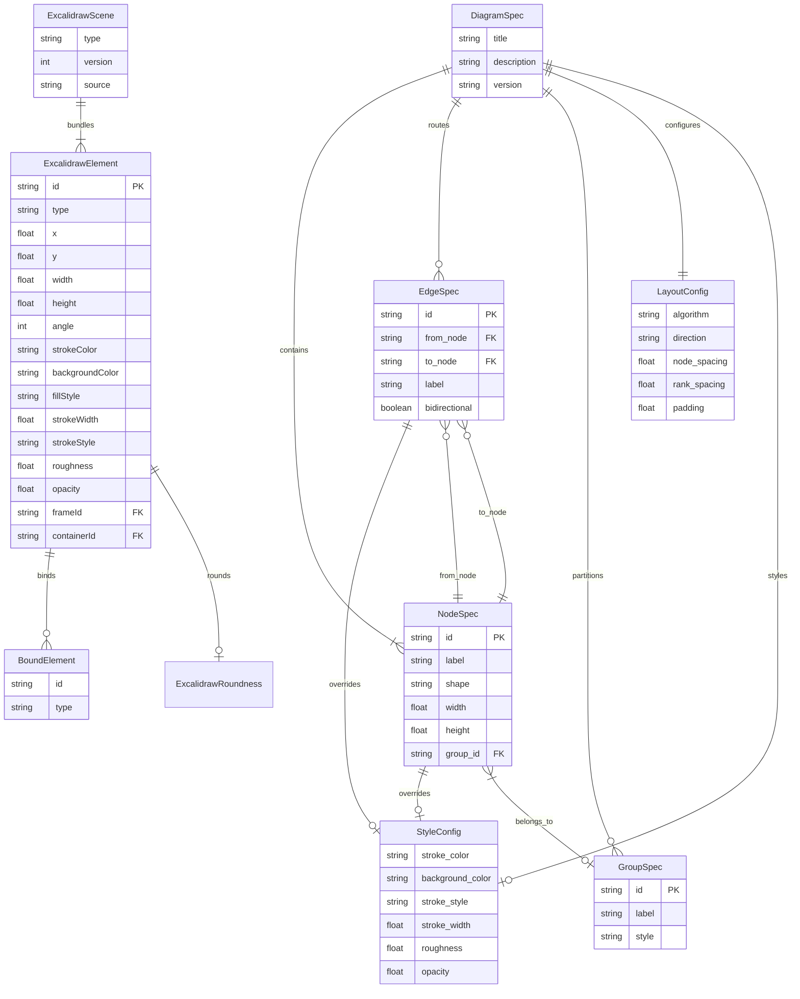

| Field | Value |
|---|---|
| Version | v1.0.0 |
| Last Updated | 2026-10-24 |
| Owner | Principal Data Architect |
| Status | Approved |

# 📄 Data Model & Schema Specification (Schema) — Sketchwright

## 1. Entity-Relationship (ER) Diagram



---

## 2. Model & Entity Definitions

### 2.1 Entity: `DiagramSpec` (`TBL-spec`)
- **Purpose**: Root input container representing an abstract system diagram before geometric layout.
- **Fields Table**:
| Field | Type | Nullable | Default | Constraints | Description |
|---|---|:---:|---|---|---|
| `title` | `str` | Y | `null` | Max length 128 | Optional human-readable diagram title |
| `description` | `str` | Y | `null` | Max length 512 | Markdown or prose description of the diagram |
| `nodes` | `List[NodeSpec]` | N | `[]` | Max 500 items | List of visual diagram nodes |
| `edges` | `List[EdgeSpec]` | N | `[]` | Max 1000 items | List of directional or bidirectional connecting lines |
| `groups` | `List[GroupSpec]` | N | `[]` | Max 50 items | Subsystem boundary frames enclosing nodes |
| `layout` | `LayoutConfig` | N | `LayoutConfig()` | Valid Pydantic model | Global layout algorithm settings |
| `style` | `StyleConfig` | N | `StyleConfig()` | Valid Pydantic model | Global fallback visual styles |

### 2.2 Entity: `NodeSpec` (`TBL-node`)
- **Purpose**: Represents an individual node, service, entity, or decision point.
- **Fields Table**:
| Field | Type | Nullable | Default | Constraints | Description |
|---|---|:---:|---|---|---|
| `id` | `str` | N | Required | Regex `^[a-zA-Z0-9_\-\.:]+$`, max 64 | Unique node identifier |
| `label` | `str` | N | `""` | Max length 256 | Display text rendered inside container |
| `shape` | `ShapeType` | N | `"rectangle"` | Member of `ShapeType` enum | Geometric shape representation |
| `width` | `float` | Y | `null` | Value `8.0 .. 10000.0` | Explicit width override (auto-calculated if null) |
| `height` | `float` | Y | `null` | Value `8.0 .. 10000.0` | Explicit height override (auto-calculated if null) |
| `group` | `str` | Y | `null` | Must match a valid `GroupSpec.id` | Optional enclosing boundary frame |
| `style` | `StyleConfig` | Y | `null` | Valid Pydantic model | Local node styling overrides |

### 2.3 Entity: `EdgeSpec` (`TBL-edge`)
- **Purpose**: Represents a connection, API call, dependency, or event stream between two nodes.
- **Fields Table**:
| Field | Type | Nullable | Default | Constraints | Description |
|---|---|:---:|---|---|---|
| `id` | `str` | Y | `auto-generated` | Salted SHA-256 hash | Unique edge identifier |
| `from_node` | `str` | N | Required | Must match an existing `NodeSpec.id` | Source node ID |
| `to_node` | `str` | N | Required | Must match an existing `NodeSpec.id` | Target destination node ID |
| `label` | `str` | Y | `null` | Max length 128 | Optional label text floating on edge path |
| `bidirectional`| `bool` | N | `false` | Boolean | If true, renders arrows on both endpoints |
| `style` | `StyleConfig` | Y | `null` | Valid Pydantic model | Local stroke and color overrides |

### 2.4 Entity: `GroupSpec` (`TBL-group`)
- **Purpose**: Defines visual bounding boxes or VPC frames enclosing related nodes.
- **Fields Table**:
| Field | Type | Nullable | Default | Constraints | Description |
|---|---|:---:|---|---|---|
| `id` | `str` | N | Required | Unique alphanumeric string | Boundary frame identifier |
| `label` | `str` | N | Required | Max length 128 | Title label displayed on frame header |
| `style` | `StyleConfig` | Y | `null` | Valid Pydantic model | Frame stroke and background tint overrides |

### 2.5 Entity: `LayoutConfig` (`TBL-layout-cfg`)
- **Fields Table**:
| Field | Type | Nullable | Default | Constraints | Description |
|---|---|:---:|---|---|---|
| `algorithm` | `LayoutAlgorithm` | N | `"layered"` | `"layered" \| "grid" \| "tree"` | Primary layout algorithm |
| `direction` | `LayoutDirection` | N | `"LR"` | `"LR" \| "RL" \| "TB" \| "BT"` | Geometric flow axis |
| `node_spacing` | `float` | N | `80.0` | Value `16.0 .. 1000.0` | Inter-node gap within a rank |
| `rank_spacing` | `float` | N | `120.0` | Value `32.0 .. 2000.0` | Distance between hierarchical ranks |
| `padding` | `float` | N | `40.0` | Value `8.0 .. 500.0` | Global canvas margin |

---

## 3. Relationships & Integrity Constraints
| Source Entity | Target Entity | Cardinality | Constraint / On-Delete | Justification |
|---|---|:---:|---|---|
| `EdgeSpec.from_node` | `NodeSpec.id` | `N : 1` | `RESTRICT` | Edges must never dangle from non-existent nodes |
| `EdgeSpec.to_node` | `NodeSpec.id` | `N : 1` | `RESTRICT` | Edges must never terminate at undefined targets |
| `NodeSpec.group` | `GroupSpec.id` | `N : 1` | `SET NULL` | Removing a group leaves child nodes unpartitioned |
| `ExcalidrawElement.boundElements` | `ExcalidrawElement.id` | `N : M` | `CASCADE` | Binding pointers must exist symmetrically on both elements |

---

## 4. Enumerations & Constants

### 4.1 Enum: `ShapeType`
```python
class ShapeType(str, Enum):
    RECTANGLE = "rectangle"
    ROUNDED_RECTANGLE = "rounded_rectangle"
    ELLIPSE = "ellipse"
    DIAMOND = "diamond"
    CYLINDER = "cylinder"
    TEXT = "text"
```

### 4.2 Enum: `LayoutAlgorithm` & `LayoutDirection`
```python
class LayoutAlgorithm(str, Enum):
    LAYERED = "layered"   # Sugiyama heuristic
    GRID = "grid"         # Compact matrix layout
    TREE = "tree"         # Hierarchical parent-child tree

class LayoutDirection(str, Enum):
    LR = "LR"  # Left-to-Right
    RL = "RL"  # Right-to-Left
    TB = "TB"  # Top-to-Bottom
    BT = "BT"  # Bottom-to-Top
```

### 4.3 Enum: `StrokeStyle` & `FillStyle`
```python
class StrokeStyle(str, Enum):
    SOLID = "solid"
    DASHED = "dashed"
    DOTTED = "dotted"

class FillStyle(str, Enum):
    SOLID = "solid"
    HACHURE = "hachure"
    CROSS_HATCH = "cross-hatch"
```

---

## 5. Sample Specifications

### 5.1 Sample Input JSON (`DiagramSpec`)
```json
{
  "title": "Authentication Microservice",
  "layout": {
    "algorithm": "layered",
    "direction": "LR",
    "node_spacing": 80.0,
    "rank_spacing": 120.0
  },
  "nodes": [
    {
      "id": "client",
      "label": "Web Client",
      "shape": "ellipse"
    },
    {
      "id": "gateway",
      "label": "API Gateway",
      "shape": "rounded_rectangle"
    },
    {
      "id": "auth_svc",
      "label": "Auth Service",
      "shape": "rectangle"
    },
    {
      "id": "redis_db",
      "label": "Token Cache",
      "shape": "cylinder"
    }
  ],
  "edges": [
    {
      "from_node": "client",
      "to_node": "gateway",
      "label": "POST /login"
    },
    {
      "from_node": "gateway",
      "to_node": "auth_svc",
      "label": "Verify Creds"
    },
    {
      "from_node": "auth_svc",
      "to_node": "redis_db",
      "label": "Store JWT"
    }
  ]
}
```

### 5.2 Textual DSL Specification
For rapid diagram authoring without JSON boilerplate, Sketchwright parses line-based shorthand DSL syntax:

```text
# Title and directives
title: Order Processing Flow
direction: LR
algorithm: layered

# Node definitions: [id: shape: label]
[client: rectangle: Web Client]
[gateway: rounded_rectangle: API Gateway]
[orders: rectangle: Order Service]
[db: cylinder: Postgres DB]

# Edges: source -> target: label
client -> gateway: POST /order
gateway -> orders: gRPC
orders -> db: INSERT
orders --> client: 201 Created
```

### 5.3 Serialized Excalidraw Element Record
```json
{
  "id": "elem_f8a91c3e042b5891",
  "type": "rectangle",
  "x": 240.0,
  "y": 100.0,
  "width": 140.0,
  "height": 70.0,
  "angle": 0,
  "strokeColor": "#1e1e1e",
  "backgroundColor": "#e7f5ff",
  "fillStyle": "solid",
  "strokeWidth": 2,
  "strokeStyle": "solid",
  "roughness": 1,
  "opacity": 100,
  "groupIds": [],
  "frameId": null,
  "roundness": { "type": 3 },
  "seed": 1049281,
  "version": 1,
  "versionNonce": 4928172,
  "isDeleted": false,
  "boundElements": [
    { "id": "arrow_71a4f02e93b129", "type": "arrow" }
  ],
  "updated": 1729780000000,
  "link": null,
  "locked": false
}
```

---

## 6. Data Validation Rules Matrix
| Field / Invariant | Enforced At | Validation Mechanism | Failure Action |
|---|---|---|---|
| Node ID Uniqueness | Pydantic Deserialization | Custom `@model_validator` checking duplicate IDs | Raises `ValidationError` |
| Edge Endpoint Validity | Pydantic Deserialization | Cross-reference check against registered node IDs | Raises `ValidationError` |
| Max Input Size | Byte Ingestion | `len(raw_bytes) <= limits.max_input_bytes` (1 MB) | Raises `PayloadTooLargeError` |
| Node Count Limit | Pydantic Deserialization | `len(nodes) <= limits.max_nodes` (500) | Raises `PayloadTooLargeError` |
| Finite Coordinates | Layout Computation | `math.isfinite(x) and math.isfinite(y)` | Raises `LayoutError` |
| Bounding Box Positive | Layout Computation | `width > 0 and height > 0` | Raises `LayoutError` |
| Reciprocal Bindings | Excalidraw Serialization | Validator verifies edge start/end matches node bounds | Raises `SerializationError` |

---

## 7. Related Documents

| Document | Relationship & Cross-Reference |
|---|---|
| [PRD.md](file:///f:/GITHUB/sketchwright-mcp/docs/product/PRD.md) | Requirement definitions and feature scope. |
| [TechSpec.md](file:///f:/GITHUB/sketchwright-mcp/docs/architecture/TechSpec.md) | Technical architecture and data processing pipelines. |
| [AppFlow.md](file:///f:/GITHUB/sketchwright-mcp/docs/product/AppFlow.md) | State inventory and user flow maps. |
| [Design.md](file:///f:/GITHUB/sketchwright-mcp/docs/architecture/Design.md) | Visual styling tokens, color definitions, and shape dimensions. |
| [Rules.md](file:///f:/GITHUB/sketchwright-mcp/docs/development/Rules.md) | Code style and schema synchronization invariants. |
| [API.md](file:///f:/GITHUB/sketchwright-mcp/docs/architecture/API.md) | Serialization formats for MCP tools and CLI command options. |
| [SecurityAndCompliance.md](file:///f:/GITHUB/sketchwright-mcp/docs/guides/SecurityAndCompliance.md) | System limits and memory protection invariants. |
| [Testing.md](file:///f:/GITHUB/sketchwright-mcp/docs/development/testing.md) | Unit and integration testing strategies. |
| [Deployment.md](file:///f:/GITHUB/sketchwright-mcp/docs/guides/Deployment.md) | Release procedures and client configurations. |
| [Glossary.md](file:///f:/GITHUB/sketchwright-mcp/docs/product/Glossary.md) | Definitions for domain terms and concepts. |
