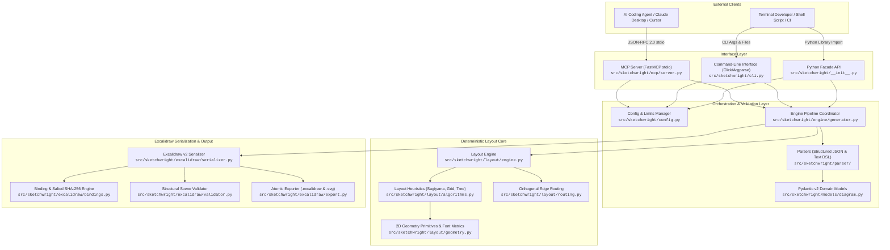
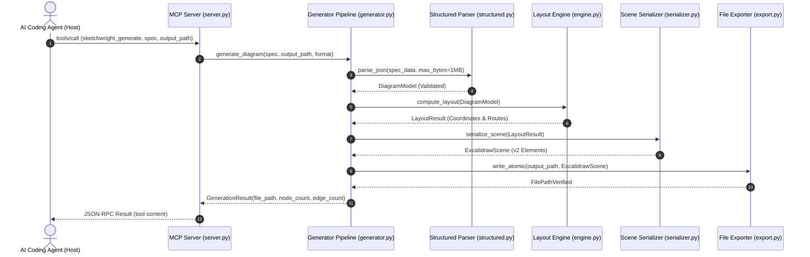
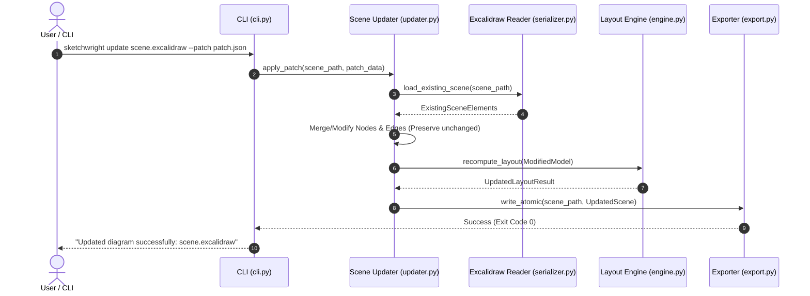
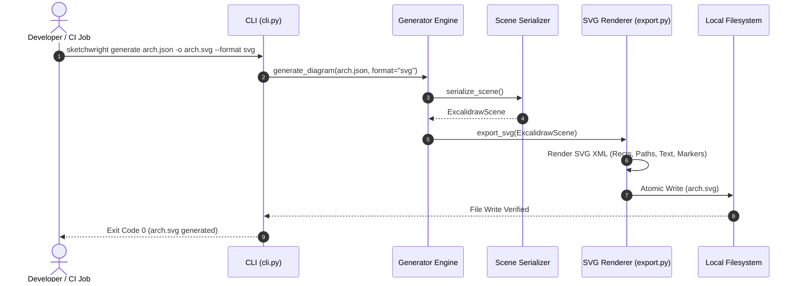

| Field | Value |
|---|---|
| Version | v1.0.0 |
| Last Updated | 2026-10-24 |
| Owner | Staff Systems Architect |
| Status | Approved |

# 📄 Technical Specification (TechSpec) — Sketchwright

## 1. Architecture Overview
Sketchwright is designed as a modular, decoupled Python system adhering to strict boundaries between protocol interfaces, diagram parsing, deterministic layout calculation, and scene serialization.

### 1.1 Module Dependencies & Unidirectional Graph
The internal module import graph is strictly unidirectional:
`Interfaces (cli, mcp)` -> `Engine` -> `Parser/Models` -> `Layout` -> `Excalidraw Output`.
- **Circular Import Cycles**: 0 (enforced via static import assertions).
- **Third-Party Runtime Dependencies**: Strictly `mcp >= 2.3.0`, `pydantic >= 2.14.0`.

---

## 2. Technology Stack & Dependency Contracts
| Component | Technology | Version | Architectural Rationale |
|---|---|---|---|
| **Language Runtime** | Python | `>=3.12` | Native support for modern typing syntax, improved exception groups, and high-performance stdio IPC. |
| **Data Validation** | Pydantic v2 | `>=2.14.0` | Rust-backed high-throughput serialization and strict constraint validation. |
| **Protocol Transport** | FastMCP Python SDK | `>=2.3.0` | Official Model Context Protocol SDK providing native stdio framing and schema introspection. |
| **Linting & Formatting** | Ruff | `>=0.3.0` | Fast Rust-based linter and formatter maintaining uniform code quality without CI drag. |
| **Static Type-Checking** | Mypy | `>=1.9.0` | Strict type enforcement (`disallow_untyped_defs = true`) eliminating runtime type faults. |
| **Testing Framework** | Pytest | `>=8.0.0` | Robust test orchestration, parameterized fixture handling, coverage reporting, and JUnit XML generation. |

---

## 3. Subsystems & Component Contracts

### 3.1 Subpackage Breakdown
| Subpackage | Primary Responsibility | Key Files |
|---|---|---|
| `sketchwright.cli` | Command-line dispatch & help screens | `cli.py` |
| `sketchwright.config` | Settings & Limits dataclasses | `config.py` |
| `sketchwright.engine` | High-level pipeline coordinator | `generator.py`, `updater.py` |
| `sketchwright.excalidraw` | Excalidraw serialization & SVG export | `serializer.py`, `validator.py`, `export.py` |
| `sketchwright.layout` | Sugiyama, tree, and grid layout engines | `algorithms.py`, `engine.py`, `routing.py` |
| `sketchwright.mcp` | Model Context Protocol stdio server | `server.py`, `tools.py` |
| `sketchwright.models` | Pydantic v2 schemas and validation | `diagram.py`, `elements.py`, `validation.py` |
| `sketchwright.parser` | JSON & DSL parsing | `structured.py`, `text.py` |

### 3.2 Layout Engine & Mathematical Formulations (`src/sketchwright/layout/`)
The native layout engine produces clean, legible, non-overlapping diagrams without external binary dependencies (e.g., Graphviz).

#### Sugiyama 4-Phase Algorithm
1. **Phase 1: Cycle Breaking (Feedback Edge Set)**:
   - Evaluated via Depth-First Search with 3-color vertex marking (`WHITE`, `GRAY`, `BLACK`).
   - Back-edges pointing to active ancestors (`GRAY`) on the recursion stack are reversed in the internal DAG, guaranteeing topological termination.
2. **Phase 2: Layer / Rank Assignment**:
   - Longest-path ranking assigns each node an integer layer:
     $$\text{rank}(v) = \max_{(u, v) \in E} (\text{rank}(u) + 1)$$
   - Nodes with 0 in-degrees reside at rank 0.
3. **Phase 3: Crossing Minimization (Barycentric Heuristic)**:
   - Nodes in rank $r > 0$ are sorted by the average index position of predecessors in rank $r - 1$:
     $$\text{barycenter}(v) = \frac{1}{|\text{pred}(v)|} \sum_{u \in \text{pred}(v)} \text{order}(u)$$
   - Stable deterministic tie-breaking is performed using alphabetical node IDs.
4. **Phase 4: Coordinate Assignment & Centering**:
   - Primary axis advances per rank; orthogonal axis advances per intra-rank position.
   - Non-overlapping guarantee holds when `node_spacing >= 50` and `rank_spacing >= 80`.

#### Edge Routing Modes
- **Orthogonal Stepped Routing**: Connects boundary anchor points using stepped polylines with clearance around node centers.
- **Backward Loop Routing**: Cyclic or feedback edges route around the outer bounding box of intermediate ranks.
- **Self-Loops**: Edges where `source == target` curl around the upper-right corner of the node in a 4-point arc.
- **Parallel Edge Offsetting**: Multiple edges sharing endpoints receive incremental perpendicular offsets to avoid visual collision.

---

## 4. Data Flow & Sequence Diagrams

### 4.1 MCP Diagram Generation Flow

### 4.2 Incremental Diagram Update Flow

### 4.3 Standalone Vector SVG Export Flow

---

## 5. Non-Functional Requirements (NFRs)
| Category | Requirement | Target Metric | How Verified |
|---|---|---|---|
| **Performance** | Generation latency for ≤ 100 nodes | p95 < 250ms | Automated benchmark suite (`tests/integration/test_pipeline.py`) |
| **Determinism** | Bit-for-bit reproducible output on identical input | 100.0% identical SHA-256 | Determinism test suite (`tests/integration/test_determinism.py`) |
| **Robustness** | Memory consumption during 1 MB payload parse | < 50 MB resident set | Memory profiling in CI |
| **Security** | Filesystem output path confinement | Zero traversal escapes | Security test suite (`tests/unit/test_export.py`) |
| **Protocol Integrity** | Clean `stdout` JSON-RPC frames | 0 non-protocol bytes on stdout | Subprocess stdio test (`tests/e2e/test_subprocess_mcp.py`) |

---

## 6. Error Handling Strategy
- **Error Hierarchy**: All exceptions inherit from `SketchwrightError` ([`src/sketchwright/errors.py`](file:///f:/GITHUB/sketchwright-mcp/src/sketchwright/errors.py)).
  - `ConfigurationError`: Invalid settings or limits.
  - `PayloadTooLargeError`: Input exceeds 1 MB or limits ceiling.
  - `ParseError`: Malformed JSON or text DSL.
  - `LayoutError`: Geometry failure or unsolvable constraint.
  - `SerializationError`: Corrupt Excalidraw element structure.
  - `SandboxViolationError`: Path traversal escape outside allowed directory.
- **Atomic Operations**: All file writing uses temporary file write (`.tmp_<uuid>`) followed by `os.replace` to prevent partial or corrupted file writes.
- **Idempotency**: All operations are stateless and deterministic; invoking `generate` with identical parameters produces identical results.

---

## 7. Related Documents

| Document | Relationship & Cross-Reference |
|---|---|
| [PRD.md](file:///f:/GITHUB/sketchwright-mcp/docs/product/PRD.md) | High-level product requirements and persona definitions. |
| [AppFlow.md](file:///f:/GITHUB/sketchwright-mcp/docs/product/AppFlow.md) | Maps CLI and MCP states to engine pipeline execution steps. |
| [Design.md](file:///f:/GITHUB/sketchwright-mcp/docs/architecture/Design.md) | Dictates the visual styling tokens and Excalidraw element properties. |
| [Schema.md](file:///f:/GITHUB/sketchwright-mcp/docs/architecture/Schema.md) | Concrete Pydantic model schemas and Excalidraw element JSON data structures. |
| [ImplementationPlan.md](file:///f:/GITHUB/sketchwright-mcp/docs/development/ImplementationPlan.md) | Phased task sequencing and architectural dependency graph. |
| [Tracker.md](file:///f:/GITHUB/sketchwright-mcp/docs/development/Tracker.md) | Living execution status of layout and architecture tasks. |
| [Rules.md](file:///f:/GITHUB/sketchwright-mcp/docs/development/Rules.md) | Operating rules and coding standards governing architecture implementation. |
| [API.md](file:///f:/GITHUB/sketchwright-mcp/docs/architecture/API.md) | FastMCP tool signatures, CLI argument specifications, and Python interfaces. |
| [SecurityAndCompliance.md](file:///f:/GITHUB/sketchwright-mcp/docs/guides/SecurityAndCompliance.md) | Detailed sandbox mechanics and threat mitigations. |
| [Testing.md](file:///f:/GITHUB/sketchwright-mcp/docs/development/testing.md) | Test suite breakdown, determinism assertions, and coverage gates. |
| [Deployment.md](file:///f:/GITHUB/sketchwright-mcp/docs/guides/Deployment.md) | CI/CD build configuration and package release procedures. |
| [Glossary.md](file:///f:/GITHUB/sketchwright-mcp/docs/product/Glossary.md) | Technical definitions for layout and architecture vocabulary. |
| [RiskRegister.md](file:///f:/GITHUB/sketchwright-mcp/docs/development/RiskRegister.md) | Architectural and operational risks with mitigations. |
