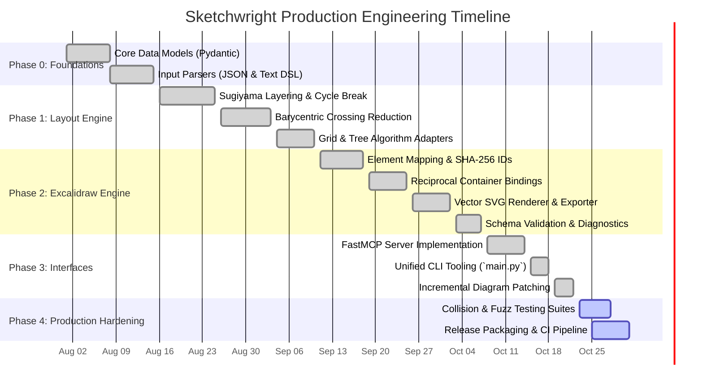
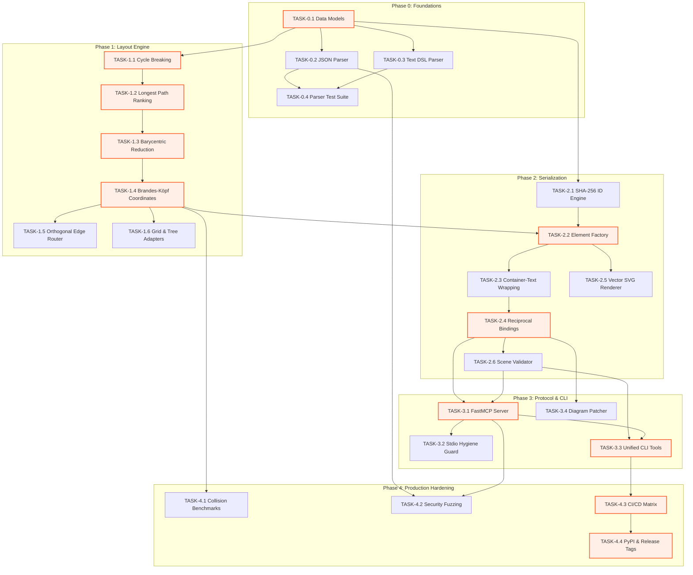

| Field | Value |
|---|---|
| Version | v1.0.0 |
| Last Updated | 2026-10-24 |
| Owner | Principal Program Manager & Lead Architect |
| Status | Approved |

# 📄 Implementation & Phased Execution Plan (ImplementationPlan) — Sketchwright

## 1. Build Philosophy
Sketchwright is constructed following four non-negotiable architectural tenets:
1. **Walking Skeleton First**: Establish end-to-end data pipelines from AST parsing to serialization early, validating interfaces before algorithmic optimization.
2. **Mathematical Determinism Before Visual Polish**: Coordinate assignments, cycle resolution, and crossing reductions must achieve bit-for-bit mathematical determinism before aesthetic enhancements.
3. **Zero-Network Security by Default**: Diagram generation must never initiate outbound network requests, execute external binary runtimes, or leak protocol diagnostics onto `stdout`.
4. **Verifiable Test Automation**: Every commit must pass rigorous static analysis (`ruff`, `mypy --strict`), unit verification, and bounding-box collision detection.

---

## 2. Master Phase Overview & Timeline



---

## 3. Detailed Phase Breakdown

### Phase 0: Data Contracts & Foundations
- **Goal**: Implement typed data structures and input parsers for structured JSON and shorthand text DSLs.
- **Entry Criteria**: Finalized [PRD.md](file:///f:/GITHUB/sketchwright-mcp/docs/product/PRD.md) requirements and [Schema.md](file:///f:/GITHUB/sketchwright-mcp/docs/architecture/Schema.md) entity definitions.
- **Exit Criteria**: 100% test pass rate on input parsing fixtures; zero type errors under `mypy --strict`.

| Task ID | Description | Depends On | Owner Role | Est. Effort | Traces To |
|---|---|---|---|:---:|---|
| `TASK-0.1` | Implement Pydantic models for `DiagramSpec`, `NodeSpec`, `EdgeSpec`, `GroupSpec`, and configs | None | Backend Dev | 3d | `REQ-004`, `TBL-spec`, `TBL-node` |
| `TASK-0.2` | Build structured JSON parser with schema validation and friendly errors | `TASK-0.1` | Backend Dev | 2d | `REQ-011`, `SCR-003` |
| `TASK-0.3` | Implement text-based shorthand DSL tokenizer and recursive descent parser | `TASK-0.1` | Backend Dev | 3d | `REQ-011`, `SCR-003` |
| `TASK-0.4` | Write comprehensive unit test suite for valid and invalid parsing edge cases | `TASK-0.2`, `TASK-0.3` | QA Engineer | 2d | `US-003`, `MET-001` |

---

### Phase 1: Mathematical Layout Engine
- **Goal**: Implement deterministic 2D graph layout algorithms ensuring zero overlapping nodes and orthogonal edge routing.
- **Entry Criteria**: Phase 0 completed and verified with test fixtures.
- **Exit Criteria**: Mathematical determinism validated across 1,000 randomized DAG and cyclic benchmark graphs.

| Task ID | Description | Depends On | Owner Role | Est. Effort | Traces To |
|---|---|---|---|:---:|---|
| `TASK-1.1` | Implement DFS-based cycle breaking with deterministic back-edge reversal | `TASK-0.1` | Algorithm Dev | 3d | `REQ-001`, `G-001` |
| `TASK-1.2` | Build longest-path layer assignment (ranking) algorithm | `TASK-1.1` | Algorithm Dev | 2d | `REQ-001`, `MET-002` |
| `TASK-1.3` | Implement multi-pass barycentric crossing reduction with stable tie-breaking | `TASK-1.2` | Algorithm Dev | 4d | `REQ-001`, `MET-002` |
| `TASK-1.4` | Implement brandes-köpf horizontal coordinate assignment respecting node padding | `TASK-1.3` | Algorithm Dev | 3d | `REQ-001`, `G-002` |
| `TASK-1.5` | Implement orthogonal edge router generating stepped polyline collision paths | `TASK-1.4` | Geometry Dev | 4d | `REQ-003`, `TBL-edge` |
| `TASK-1.6` | Implement alternative `grid` and `tree` layout adapters | `TASK-1.4` | Algorithm Dev | 2d | `REQ-002`, `SCR-002` |

---

### Phase 2: Excalidraw Engine & Serialization
- **Goal**: Transform positioned layout geometries into official Excalidraw v2 element JSON and pure vector SVG.
- **Entry Criteria**: Phase 1 layout coordinates available and validated.
- **Exit Criteria**: Excalidraw JSON loads without errors in official web app; SVG passes XML schema checks.

| Task ID | Description | Depends On | Owner Role | Est. Effort | Traces To |
|---|---|---|---|:---:|---|
| `TASK-2.1` | Implement salted SHA-256 deterministic element ID generation | `TASK-0.1` | Backend Dev | 1d | `REQ-006`, `TBL-elem` |
| `TASK-2.2` | Implement Excalidraw element factory (`rectangle`, `ellipse`, `diamond`, `cylinder`) | `TASK-2.1` | Frontend/Backend | 3d | `REQ-004`, `TBL-elem` |
| `TASK-2.3` | Build container-text auto-wrapping with font width approximation | `TASK-2.2` | UX/Core Dev | 2d | `REQ-005`, `SCR-008` |
| `TASK-2.4` | Implement bi-directional `boundElements` and `containerId` relational linkages | `TASK-2.3` | Core Dev | 2d | `REQ-006`, `TBL-bound` |
| `TASK-2.5` | Build standalone vector SVG generator with embedded styling and text | `TASK-2.2` | Graphics Dev | 3d | `REQ-007`, `US-002` |
| `TASK-2.6` | Implement standalone Excalidraw scene validator checking geometry and binding sanity | `TASK-2.4` | QA/Core Dev | 2d | `REQ-008`, `SCR-004` |

---

### Phase 3: Interfaces, FastMCP & CLI
- **Goal**: Deliver unified developer touchpoints via standard POSIX CLI and JSON-RPC 2.0 stdio FastMCP server.
- **Entry Criteria**: Phase 2 serializer and validator operational.
- **Exit Criteria**: Validated stdio MCP protocol compliance via Claude Desktop and MCP Inspector.

| Task ID | Description | Depends On | Owner Role | Est. Effort | Traces To |
|---|---|---|---|:---:|---|
| `TASK-3.1` | Construct FastMCP stdio server registering 6 tools, 3 resources, and 3 prompts | `TASK-2.4`, `TASK-2.6` | Protocols Dev | 3d | `REQ-009`, `SCR-006` |
| `TASK-3.2` | Enforce strict stdio hygiene: zero diagnostic prints to `stdout`, all logs to `stderr` | `TASK-3.1` | Protocols Dev | 1d | `REQ-009`, `SCR-007` |
| `TASK-3.3` | Implement Typer/Click CLI commands: `generate`, `layout`, `validate`, `capabilities`, `mcp` | `TASK-2.6`, `TASK-3.1` | CLI Dev | 2d | `REQ-010`, `SCR-001` |
| `TASK-3.4` | Implement incremental diagram update and patching engine | `TASK-2.4` | Core Dev | 3d | `REQ-007`, `SCR-005` |

---

### Phase 4: Production Hardening & CI/CD
- **Goal**: Execute security fuzzing, collision verification, CI pipeline hardening, and package publication.
- **Entry Criteria**: All functional phases merged and passing basic tests.
- **Exit Criteria**: 100% test pass rate across 99+ tests, 0 security vulnerabilities, PyPI wheel verified.

| Task ID | Description | Depends On | Owner Role | Est. Effort | Traces To |
|---|---|---|---|:---:|---|
| `TASK-4.1` | Implement automated bounding-box collision detection benchmark suite | `TASK-1.4` | QA Engineer | 2d | `MET-002`, `G-002` |
| `TASK-4.2` | Security fuzzing: test input size limits (1MB), deep recursion, and path traversal | `TASK-0.2`, `TASK-3.1` | SecOps Dev | 2d | `MET-005`, `PRD:Risks` |
| `TASK-4.3` | Set up GitHub Actions CI: linting (`ruff`), typing (`mypy`), tests across Python 3.12+ | `TASK-3.3` | DevOps | 2d | `G-001`, `MET-004` |
| `TASK-4.4` | Configure automated build artifacts and release tagging (`hatchling` / `uv build`) | `TASK-4.3` | DevOps | 1d | `ImplementationPlan:Rollout` |

---

## 4. Architectural Dependency Graph



---

## 5. Developer Environment & Tooling Setup Checklist

New contributors and AI coding agents must execute the following setup sequence:

- [ ] **Step 1: Runtime Verification**
  - Verify Python version: `python --version` (Required: >= 3.12).
  - Verify `uv` package manager: `uv --version` (Required: >= 0.5.0).
- [ ] **Step 2: Environment Sync**
  - Synchronize virtual environment with frozen dependencies:
    ```bash
    uv sync --frozen
    ```
- [ ] **Step 3: Verification Pass**
  - Run code formatting and lint verification:
    ```bash
    uv run ruff check .
    uv run ruff format --check .
    ```
  - Run strict static type checking:
    ```bash
    uv run mypy src/sketchwright
    ```
  - Execute full unit test suite:
    ```bash
    uv run pytest
    ```
- [ ] **Step 4: MCP Verification**
  - Test FastMCP stdio server launch without outputting extraneous tokens:
    ```bash
    uv run sketchwright mcp --help
    ```

---

## 6. Rollout & Release Strategy

### 6.1 Versioning Policy
Sketchwright follows strict Semantic Versioning (`MAJOR.MINOR.PATCH`):
- **MAJOR**: Breaking changes to input schema ([Schema.md](file:///f:/GITHUB/sketchwright-mcp/docs/architecture/Schema.md)), CLI argument flags, or MCP tool signatures.
- **MINOR**: New layout algorithms, additional shape primitives, enhanced styling tokens, or non-breaking tools.
- **PATCH**: Bug fixes in geometric routing, binding adjustments, or performance optimizations.

### 6.2 Distribution Channels
1. **PyPI Package**: Distribute pure-Python source archive (`.tar.gz`) and platform-independent wheel (`.whl`) via GitHub Actions trusted publishing.
2. **MCP Client Configuration**: Distribute pre-configured JSON blocks for Claude Desktop, Cursor, and Windsurf (`examples/mcp-client-config.example.json`).
3. **Container / Headless Run**: Provide standalone OCI container configuration for isolated CI/CD runners.

---

## 7. Global Definition of Done (DoD)

A task in `ImplementationPlan.md` cannot be marked as **Done** unless it satisfies the following checklist:

- [ ] **Code Quality**: Passes `ruff check .` with zero lint warnings and standard formatting.
- [ ] **Type Safety**: Passes `mypy src/sketchwright` under strict mode with no `# type: ignore` without inline justification.
- [ ] **Test Coverage**: Accompanied by unit tests; overall project test coverage remains above 90%.
- [ ] **Mathematical Determinism**: Consecutive runs on identical input produce identical output SHA-256 hashes.
- [ ] **Documentation**: Any updated interfaces, options, or schemas are simultaneously updated in `Schema.md`, `TechSpec.md`, and `Tracker.md`.
- [ ] **Stdio Isolation**: Zero debug, informational, or warning prints on `stdout` (MCP compliance invariant).

---

## 8. Related Documents

| Document | Relationship & Cross-Reference |
|---|---|
| [PRD.md](file:///f:/GITHUB/sketchwright-mcp/docs/product/PRD.md) | Defines the functional requirements (`REQ-###`) and user stories (`US-###`) mapped to build phases. |
| [TechSpec.md](file:///f:/GITHUB/sketchwright-mcp/docs/architecture/TechSpec.md) | Details the technical architecture, data pipelines, and internal module contracts. |
| [AppFlow.md](file:///f:/GITHUB/sketchwright-mcp/docs/product/AppFlow.md) | Specifies CLI screen transitions and MCP protocol state machines implemented across phases. |
| [Design.md](file:///f:/GITHUB/sketchwright-mcp/docs/architecture/Design.md) | Dictates the visual styling tokens and Excalidraw element properties applied in Phase 2. |
| [Schema.md](file:///f:/GITHUB/sketchwright-mcp/docs/architecture/Schema.md) | Documents the entity models (`TBL-###`) implemented in Phase 0. |
| [Tracker.md](file:///f:/GITHUB/sketchwright-mcp/docs/development/Tracker.md) | Tracks the live execution status and milestone completion of every `TASK-#.#`. |
| [Rules.md](file:///f:/GITHUB/sketchwright-mcp/docs/development/Rules.md) | Enforces the coding standards and AI-agent operating rules during task execution. |
| [API.md](file:///f:/GITHUB/sketchwright-mcp/docs/architecture/API.md) | Details the MCP tool signatures and CLI options delivered in Phase 3. |
| [SecurityAndCompliance.md](file:///f:/GITHUB/sketchwright-mcp/docs/guides/SecurityAndCompliance.md) | Details threat models and sanitization invariants verified in Phase 4. |
| [Testing.md](file:///f:/GITHUB/sketchwright-mcp/docs/development/testing.md) | Defines the comprehensive test strategy and automated CI test execution gates. |
| [Deployment.md](file:///f:/GITHUB/sketchwright-mcp/docs/guides/Deployment.md) | Details package deployment, release automation, and environment setup. |
| [Glossary.md](file:///f:/GITHUB/sketchwright-mcp/docs/product/Glossary.md) | Defines technical terms like Sugiyama, barycenter, and reciprocal binding. |
| [RiskRegister.md](file:///f:/GITHUB/sketchwright-mcp/docs/development/RiskRegister.md) | Identifies operational and algorithmic risks tracked throughout project execution. |
