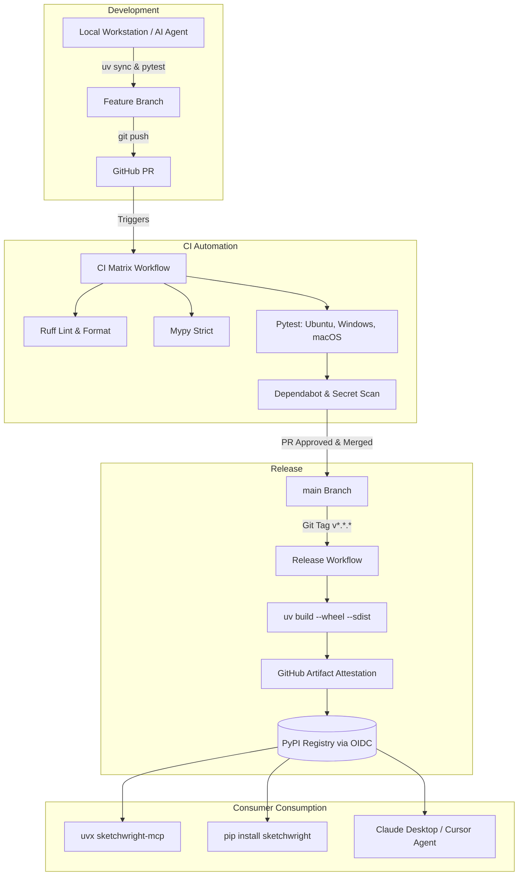

| Field | Value |
|---|---|
| Version | v1.0.0 |
| Last Updated | 2026-10-24 |
| Owner | Lead DevOps & Release Engineer |
| Status | Approved |

# 📄 Build, Release & Deployment Guide (Deployment) — Sketchwright

## 1. Release Architecture & Environments
Because Sketchwright is distributed as an open-source Python package and standalone CLI/MCP utility, deployment refers to package compilation, artifact signing, and automated distribution to the **Python Package Index (PyPI)** and local user environments.



---

## 2. Environment Promotion Flow

| Environment | Purpose | Target Audience | Access & Trigger Mechanism |
|---|---|---|---|
| **Local Dev** | Feature development, fast unit tests, algorithm validation | Individual Contributors & AI Agents | `uv run pytest` / `uv run sketchwright` |
| **Pull Request (CI)** | Multi-OS regression testing, linting, secret detection | Automated GitHub Runners | Push to PR branch |
| **Main Branch** | Stable trunk; canonical source of truth | Maintainers & Collaborators | Squash and merge via PR |
| **Production (PyPI)** | Public distribution of versioned wheels and source archives | Global Developers & AI Coding Agents | Push of SemVer tag (e.g., `git tag v1.0.0`) |

---

## 3. Local Installation & Development Setup

### 3.1 Windows (PowerShell)
```powershell
# 1. Clone repository
git clone https://github.com/themanoj-025/sketchwright-mcp.git
Set-Location sketchwright-mcp

# 2. Synchronize virtual environment with all dependencies
uv sync --all-groups

# 3. Verify installation
uv run sketchwright --version
uv run sketchwright capabilities
```

### 3.2 Linux / macOS (Bash / Zsh)
```bash
# 1. Clone repository
git clone https://github.com/themanoj-025/sketchwright-mcp.git
cd sketchwright-mcp

# 2. Synchronize virtual environment with all dependencies
uv sync --all-groups

# 3. Verify installation
uv run sketchwright --version
uv run sketchwright capabilities
```

---

## 4. Package Build & Publication Pipeline

Sketchwright uses PEP 517/621 build standards powered by `hatchling` and `uv`:

### 4.1 Local Packaging Verification
```bash
# Clean previous build artifacts
rm -rf dist/ build/

# Build source distribution and binary wheel
uv build

# Validate wheel contents and metadata
uv run twine check dist/*
```

This creates:
- `dist/sketchwright-0.1.0-py3-none-any.whl`
- `dist/sketchwright-0.1.0.tar.gz`

### 4.2 Automated Publishing via OpenID Connect (OIDC)
- Releases do not require hardcoded PyPI API tokens.
- GitHub Actions uses PyPI's trusted publisher OIDC minting to generate short-lived cryptographic tokens for artifact uploads.

---

## 5. Rollback & Emergency Triage Procedure

If a published PyPI release exhibits a critical regression (e.g., coordinate corruption, memory leak, or broken MCP stdio transport):

1. **Yank Broken Release**:
   ```bash
   uv run twine yank sketchwright <broken-version> -r pypi
   ```
   *Yanking prevents new installs while preserving reproducibility for pinned lockfiles.*
2. **Revert Faulty Commit**:
   - Create hotfix branch from `main`: `git checkout -b hotfix/revert-<commit>`
   - Revert commit: `git revert <commit-hash>`
   - Run full CI verification: `uv run pytest`
3. **Issue Patch Release**:
   - Bump patch version in `pyproject.toml` (e.g., `v1.0.1`).
   - Push commit and tag:
     ```bash
     git commit -am "fix: hotfix revert of faulty layout routing"
     git tag v1.0.1
     git push origin main --tags
     ```
4. **Broadcast Notification**:
   - Publish GitHub Release advisory noting the yanked version and remediation steps.

---

## 6. Consumer Configuration & Integration Runbook

### 6.1 Claude Desktop Integration
Add the following block to `claude_desktop_config.json`:
```json
{
  "mcpServers": {
    "sketchwright": {
      "command": "uvx",
      "args": ["sketchwright-mcp"]
    }
  }
}
```

### 6.2 Cursor IDE Integration
In Cursor Settings > Features > MCP:
- **Type**: `command`
- **Command**: `uvx sketchwright-mcp`

---

## 7. Related Documents

| Document | Relationship & Cross-Reference |
|---|---|
| [PRD.md](file:///f:/GITHUB/sketchwright-mcp/docs/product/PRD.md) | Maps release bar to release criteria in Section 11. |
| [TechSpec.md](file:///f:/GITHUB/sketchwright-mcp/docs/architecture/TechSpec.md) | Details packaging architecture and dependency specifications. |
| [AppFlow.md](file:///f:/GITHUB/sketchwright-mcp/docs/product/AppFlow.md) | Outlines entry points activated during deployment. |
| [Design.md](file:///f:/GITHUB/sketchwright-mcp/docs/architecture/Design.md) | Enforces asset packaging requirements. |
| [Schema.md](file:///f:/GITHUB/sketchwright-mcp/docs/architecture/Schema.md) | Provides data models that determine major SemVer release bumps. |
| [ImplementationPlan.md](file:///f:/GITHUB/sketchwright-mcp/docs/development/ImplementationPlan.md) | Outlines Phase 4 rollout tasks (`TASK-4.3`, `TASK-4.4`). |
| [Tracker.md](file:///f:/GITHUB/sketchwright-mcp/docs/development/Tracker.md) | Tracks the active deployment status and release timeline. |
| [Rules.md](file:///f:/GITHUB/sketchwright-mcp/docs/development/Rules.md) | Governs git workflow and branching conventions. |
| [API.md](file:///f:/GITHUB/sketchwright-mcp/docs/architecture/API.md) | Documents the versioning policy for all public endpoints. |
| [SecurityAndCompliance.md](file:///f:/GITHUB/sketchwright-mcp/docs/guides/SecurityAndCompliance.md) | Details OIDC authentication and supply chain security. |
| [Testing.md](file:///f:/GITHUB/sketchwright-mcp/docs/development/testing.md) | Specifies CI test gates required prior to release promotion. |
| [Glossary.md](file:///f:/GITHUB/sketchwright-mcp/docs/product/Glossary.md) | Defines packaging terms such as wheel, sdist, and OIDC. |
| [RiskRegister.md](file:///f:/GITHUB/sketchwright-mcp/docs/development/RiskRegister.md) | Documents deployment failure risks and mitigations. |
