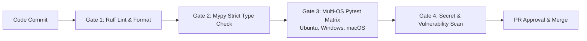

| Field | Value |
|---|---|
| Version | v1.0.0 |
| Last Updated | 2026-10-24 |
| Owner | Lead QA & Test Automation Architect |
| Status | Approved |

# 📄 Quality Assurance & Testing Strategy (Testing) — Sketchwright

## 1. Test Strategy & Architectural Pyramid

Sketchwright employs a multi-tiered test automation strategy designed to guarantee mathematical determinism, zero node collisions, schema validity, and protocol hygiene.

```mermaid
graph TD
    subgraph Testing Pyramid
        E2E[End-to-End & Protocol Compliance Tests<br/>MCP Inspector & CLI Execution Matrix (10%)]
        INT[Integration & Property Benchmarks<br/>Deterministic Hashes & Collision Fuzzing (25%)]
        UNIT[Unit Test Suite<br/>Parsers, Geometry, Layouts, Models, Serializers (65%)]
    end
    E2E --> INT
    INT --> UNIT
```

### 1.1 Testing Principles
- **Fast Feedback**: Unit tests must complete within **5 seconds** locally.
- **Bit-for-Bit Determinism**: The test runner verifies that consecutive executions on identical graph specs yield identical SHA-256 output hashes.
- **Zero Collision Guarantee**: Automated bounding-box collision sweeps test random Directed Acyclic Graphs (DAGs) and cyclic graphs up to 100 nodes.
- **Stdio Hygiene Assertion**: All MCP integration tests capture stdout to assert zero leakage of unstructured diagnostic logs.

---

## 2. Test Execution & Coverage Targets

| Test Suite | Directory | Framework | Target Coverage | Execution Frequency |
|---|---|---|:---:|---|
| **Unit Tests** | `tests/unit/` | `pytest` | > 92% | Every commit & local pre-commit |
| **Integration Tests** | `tests/integration/` | `pytest` + `pytest-asyncio` | > 88% | Every pull request |
| **Contract Tests** | `tests/contract/` | `pytest` + `mcp.server` | 100% | Every pull request |
| **E2E Subprocess Tests** | `tests/e2e/` | `pytest` + subprocess stdio | 100% | Nightly & Release candidate |
| **Collision Benchmarks** | `tests/benchmarks/` | `pytest-benchmark` | N/A | Nightly CI / Release candidate |
| **Lint & Formatting** | Root | `ruff check`, `ruff format` | 100% | Pre-commit & CI matrix |
| **Static Type Safety** | `src/sketchwright` | `mypy --strict` | 100% | Pre-commit & CI matrix |

### 2.1 Test Suite Inventory & File Map

```bash
# Run the complete test suite
uv run pytest -v

# Run with test coverage report
uv run pytest --cov=sketchwright tests/
```

#### Unit Tests (`tests/unit/`)
- `test_models.py`: Validates Pydantic specifications, unique ID enforcement, resource limits, and finite numeric bounds.
- `test_parser.py`: Tests JSON string/file decoding, payload size limits, and line-based text DSL parsing.
- `test_geometry.py`: Verifies `Point`, `Rect`, ray-shape perimeter anchors, and text sizing heuristics.
- `test_layout.py`: Verifies Sugiyama ranking, cycle breaking termination, multi-directional flow, and grid fallback.
- `test_serializer.py`: Verifies Excalidraw element properties, reciprocal container bindings, and arrow bindings.
- `test_validator.py`: Tests scene validator against structural defects, dangling references, and non-finite coordinates.
- `test_export.py`: Tests atomic file writing, overwrite protection, and standalone SVG generation.
- `test_cli.py`: Verifies CLI arguments, help text, version output, and documented exit codes (0, 1, 2).

#### Integration Tests (`tests/integration/`)
- `test_pipeline.py`: Runs full pipeline across representative fixtures (architecture, flowchart, cyclic state machine, disconnected clusters, unicode characters) and verifies scene validity.
- `test_determinism.py`: Asserts that repeated generation runs produce byte-for-byte and semantically identical outputs.

#### Contract Tests (`tests/contract/`)
- `test_mcp_server.py`: Uses the official `mcp.server.mcpserver.MCPServer` in-process interface to verify:
  - Tool discovery for all tools (`sketchwright_generate`, `sketchwright_validate`, `sketchwright_layout`, `sketchwright_update`, `sketchwright_capabilities`, `sketchwright_export_svg`).
  - Correct argument schemas and structured responses.
  - Resource listings (`sketchwright://capabilities`, `sketchwright://schemas/diagram`).
  - Prompt templates (`sketchwright_system_architecture`, `sketchwright_flowchart`).

#### End-to-End Tests (`tests/e2e/`)
- `test_subprocess_mcp.py`: Launches `sketchwright mcp` in a live subprocess, performs a real JSON-RPC `initialize` handshake over stdio, and verifies that stdout is strictly reserved for protocol frames.

---

## 3. Critical Test Cases Matrix

| Test Case ID | Feature / Component | Test Scenario & Verification Objective | Input Condition | Expected Result | Priority |
|---|---|---|---|---|:---:|
| `TC-001` | Sugiyama Layout | Verify cycle-breaking algorithm resolves multi-node loops | Graph with cyclic edges `A->B->C->A` | Ranks assigned without recursion errors | **P0** |
| `TC-002` | Determinism Engine | Verify bit-for-bit repeatability across repeated runs | Identical 20-node DAG spec | SHA-256 hash identical on 10 consecutive runs | **P0** |
| `TC-003` | Collision Detector | Verify zero overlapping bounding boxes on 50-node graph | Random DAG with varying node dimensions | Total node intersection area == 0.0 | **P0** |
| `TC-004` | Container-Text Binding | Verify label wrapping and container dimension calculations | Long text label (150 chars) in rectangle | Label wraps; box height expands; bindings link | **P0** |
| `TC-005` | FastMCP Stdio Server | Verify clean JSON-RPC communication on stdio | `tools/call` for `sketchwright_generate` | Valid JSON-RPC frame on stdout; zero leaks | **P0** |
| `TC-006` | Standalone SVG Exporter | Verify generated SVG conforms to XML schema | Abstract system graph | Valid XML; rough styling; renders in browser | **P1** |
| `TC-007` | Scene Validator | Detect broken reciprocal bindings | Scene JSON with invalid `containerId` | Validator flags `orphan_binding` error | **P0** |
| `TC-008` | Text DSL Parser | Parse shorthand line-based syntax with custom styling | `[A: "API Gateway"] --> [B: "Auth Service"]` | Valid `DiagramSpec` Pydantic model emitted | **P1** |
| `TC-009` | Payload Ceiling Guard | Reject input files exceeding 1 MB | 1.2 MB generated JSON spec file | Fails fast with `413 Payload Too Large` | **P0** |
| `TC-010` | Path Traversal Defense | Reject output paths attempting `../../etc/passwd` | Output path containing directory traversal | `ValueError` raised; zero files created | **P0** |

---

## 4. Test Data Strategy & Fixtures

- **Golden Fixtures**: Pre-calculated `.excalidraw` scenes stored in `tests/fixtures/golden/` serve as regression benchmarks for element geometry.
- **Random Graph Synthesizer**: Parametric generator creates DAGs and cyclic topologies with configurable density, node widths, and cluster groupings.
- **Malicious Payload Suite**: Fuzzing vectors including cyclic loops, deep nesting, special characters, emoji labels, and oversized payloads.

---

## 5. Continuous Integration (CI) Quality Gates

The GitHub Actions pipeline (`.github/workflows/ci.yml`) enforces four serial quality gates on all pull requests:



---

## 6. Related Documents

| Document | Relationship & Cross-Reference |
|---|---|
| [PRD.md](file:///f:/GITHUB/sketchwright-mcp/docs/PRD.md) | Maps test cases (`TC-###`) back to acceptance criteria in user stories (`US-###`). |
| [TechSpec.md](file:///f:/GITHUB/sketchwright-mcp/docs/TechSpec.md) | Outlines component architecture validated by the unit test suite. |
| [AppFlow.md](file:///f:/GITHUB/sketchwright-mcp/docs/AppFlow.md) | Details screen transitions and CLI error codes verified in test cases. |
| [Design.md](file:///f:/GITHUB/sketchwright-mcp/docs/Design.md) | Enforces visual styling assertions tested in SVG and Excalidraw suites. |
| [Schema.md](file:///f:/GITHUB/sketchwright-mcp/docs/Schema.md) | Supplies Pydantic validation schemas tested in parser verification. |
| [ImplementationPlan.md](file:///f:/GITHUB/sketchwright-mcp/docs/ImplementationPlan.md) | Tracks execution of test framework tasks (`TASK-0.4`, `TASK-4.1`). |
| [Tracker.md](file:///f:/GITHUB/sketchwright-mcp/docs/Tracker.md) | Reports the live test pass rate and blocker resolutions. |
| [Rules.md](file:///f:/GITHUB/sketchwright-mcp/docs/Rules.md) | Enforces test coverage minimums (`RULE-007`) and testing operating rules. |
| [API.md](file:///f:/GITHUB/sketchwright-mcp/docs/API.md) | Defines contract interfaces validated in integration tests. |
| [SecurityAndCompliance.md](file:///f:/GITHUB/sketchwright-mcp/docs/SecurityAndCompliance.md) | Details security fuzzing and path traversal defenses validated by tests. |
| [Deployment.md](file:///f:/GITHUB/sketchwright-mcp/docs/Deployment.md) | Specifies CI pipeline gates and release automation. |
| [Glossary.md](file:///f:/GITHUB/sketchwright-mcp/docs/Glossary.md) | Defines testing terminology including golden fixtures and determinism. |
| [RiskRegister.md](file:///f:/GITHUB/sketchwright-mcp/docs/RiskRegister.md) | Documents quality risks and test mitigations. |
